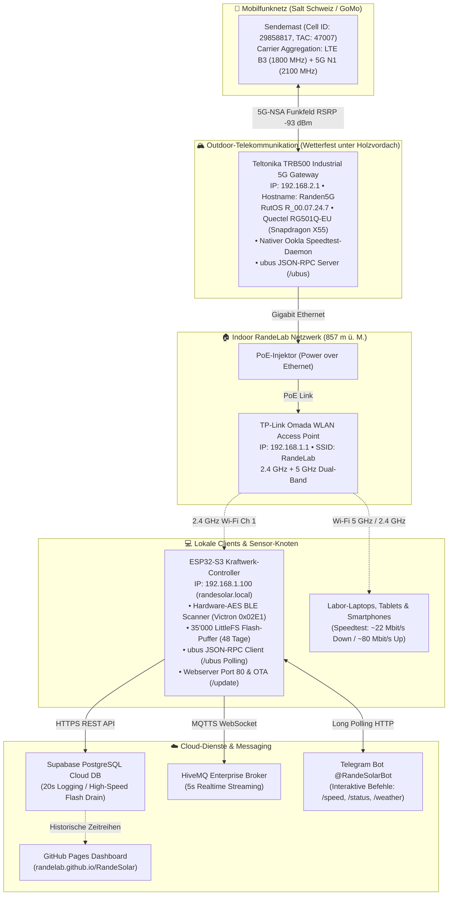

# 🌐 RandeLab 5G-Netzwerk- & Telekommunikations-Infrastruktur

**Standort:** RandeLab • Underes Ätzisloo 189, 8232 Merishausen / Randen  
**Koordinaten:** 47.7701° N, 8.5738° E • **857 m ü. M.** (Amtl. Gebäudeadresse GWR / Swisstopo)  
**Systemtyp:** Autonomes Dual-WAN / 5G-Mobilfunk-Inselnetzwerk mit ubus JSON-RPC Telemetrie  
**Stand:** November 2026  
**Schwesterdokument:** 👉 [**`SOLAR_SYSTEM_ARCHITECTURE.md`**](./SOLAR_SYSTEM_ARCHITECTURE.md) (PV-Kraftwerk, Batteriespeicher & 230V-Inverter)

---

## 1. Netzwerk-Topologie & Blockschaltbild

Das RandeLab verfügt über eine zweistufige Industrie-Netzwerkarchitektur. Die Trennung in ein wetterfestes Outdoor-5G-Gateway und einen geschützten Indoor-WLAN-Access-Point sorgt für optimale Funkfeldabdeckung und stabile Labor-Konnektivität:



---

## 2. Fotodokumentation der Hardware vor Ort

| Outdoor 4G/5G Teltonika Gateway | Indoor TP-Link Omada WLAN-Router |
| :---: | :---: |
|  |  |
| *Wetterfeste Teltonika TRB500 Station (`192.168.2.1`) geschützt unter dem Holzvordach* | *TP-Link Access Point (`192.168.1.1`) mit PoE-Speisung im RandeLab-Innenraum* |

---

## 3. Technische Spezifikationen der Komponenten

### 3.1 Teltonika TRB500 (Industrial 5G Cellular Gateway)
* **Betriebssystem:** RutOS `R_00.07.24.7` (OpenWrt-basierte gehärtete Industrie-Firmware)
* **Mobilfunk-Modem:** **Quectel RG501Q-EU** (Qualcomm Snapdragon X55 5G Modem-RF System)
* **Architektur:** 5G NR NSA & SA (3GPP Release 15)
* **Theoretische Datenraten:** Bis zu 2.1 Gbit/s Download / bis zu 900 Mbit/s Upload
* **Schnittstellen:** 1× Gigabit Ethernet (RJ45), 4× SMA-Buchsen für externe 5G/LTE-MIMO-Antennen
* **IP-Adresse WAN-Gateway:** `192.168.2.1` (WebUI & ubus JSON-RPC auf Port 80/443)
* **Aktuelle Funkzelle (Live-Telemetrie):**
  * **Provider:** **GoMo (Salt Schweiz)**
  * **Cell ID:** `29858817` (TAC: `47007`, Physical Cell ID: `54`)
  * **Modus:** `5G-NSA` (Non-Standalone)
  * **Primärträger (4G-Anker):** **LTE Band 3 (1800 MHz)** • 20 MHz Kanalbandbreite
  * **Sekundärträger (5G-Zusatz):** **5G Band N1 (2100 MHz)** • 20 MHz Kanalbandbreite
  * **Modem-Betriebstemperatur:** ca. 24.0 °C – 28.0 °C

### 3.2 TP-Link Omada Access Point
* **Rolle:** Interner WLAN-Access-Point und Layer-2/3-Switch
* **IP-Adresse:** `192.168.1.1`
* **WLAN-SSID:** `RandeLab` (WPA2-PSK)
* **Stromversorgung:** Power over Ethernet (PoE) über Injektor
* **ESP32-Verbindung:** 2.4 GHz Wi-Fi (Kanal 1), Signalstärke: `-40 dBm bis -45 dBm` (100% Link-Qualität)

---

## 4. 5G Mobilfunk-Physik auf 857 m ü. M. im Randen-Wald

### 4.1 Die Live-HF-Metriken im Detail

Über die ubus-Schnittstelle liest der ESP32-S3 alle 60 Sekunden die echten Hochfrequenz-Messwerte des Modems aus:

| Parameter | Aktueller Live-Wert | Bewertung | Physikalische Bedeutung |
| :--- | :---: | :---: | :--- |
| **RSRP (Reference Signal Received Power)** | **`-93 dBm`** | **Sehr gut** | Die reine physikalische Trägerfeldstärke am Standort ist kräftig. Es gibt kein grundlegendes Signalproblem. |
| **SINR (Signal-to-Interference-plus-Noise)** | **`-3 dB bis -1 dB`** | **Mässig bis kritisch** | Das Rauschen/Störsignal überwiegt das Nutzsignal! Hauptursache für Geschwindigkeitsdrosselung. |
| **RSRQ (Reference Signal Received Quality)** | **`-14 bis -15 dB`** | **Befriedigend** | Zeigt an, dass der Funkkanal durch Nachbarzellen oder Reflexionen belegt ist. |
| **Signal Quality (RutOS)** | **`37% – 40%`** | **Solide** | Aggregierter Qualitätsindex des Quectel-Modems. |

### 4.2 Die Asymmetrie-Analyse: Warum 80 Mbit/s Upload, aber nur 20 Mbit/s Download?

Ein nativer Speedtest direkt vom Router sowie die Referenzmessung vom Laptop liefern verblüffende Messwerte:
* ⬇️ **Download:** **`20.24 – 22.21 Mbit/s`**
* ⬆️ **Upload:** **`78.33 – 80.56 Mbit/s`**

In 95% aller Internetanschlüsse ist der Download 5- bis 10-mal schneller als der Upload. Dass es am RandeLab **umgekehrt** ist (Upload fast viermal schneller als Download!), hat handfeste physikalische und netzwerktechnische Gründe:

1. **Kein Sendestärkeproblem des Standorts:**
   Da der Router Daten mit satten 80 Mbit/s zur Basisstation funken kann, ist die Sendeantenne und die Ausrichtung hervorragend.
2. **Mast-Downlink-Auslastung (Cell Congestion):**
   Auf dem Sendemast teilen sich alle angemeldeten Mobilfunkkunden denselben Download-Frequenzblock. Wenn Wanderer, Nachbardörfer oder andere Teilnehmer streamen, sinkt die Download-Bandbreite drastisch ein. Der Uplink hingegen wird von normalen Mobilfunknutzern kaum beansprucht und ist frei.
3. **Modulationsstufen & negativer SINR (`-3 dB`):**
   * Bei idealem Empfang (`SINR > +15 dB`) nutzt 5G die Modulationsstufe **256-QAM** (überträgt 8 Bit pro Symbol).
   * Sinkt der SINR wie am RandeLab auf **`-3 dB`**, muss das Modem im Downlink auf **16-QAM** oder **QPSK** (nur 2 bis 4 Bit pro Symbol) herunterschalten. Dadurch bricht der theoretische Durchsatz um mehr als 60% ein.
4. **Feuchtes Blätterdach & Reflexionen:**
   Der Randen ist dicht bewaldet. Die aktuell genutzten Frequenzen (1.8 GHz und 2.1 GHz) haben eine Wellenlänge von ca. 14–16 cm — genau in der Grössenordnung nasser Blätter und Äste. Diese wirken bei Regen und dichtem Hochnebel wie ein absorbierender und streuender Filter (*Multipath Fading*).

---

## 5. Speed-Tuning: Frequenzband- & Funkzellen-Optimierung

Im Teltonika TRB500 lässt sich über **Network → Mobile → Band Selection** die automatische Frequenzwahl auf manuelle Band- und Zellensteuerung umstellen. Folgende Hebel stehen zur Verfügung:

### 5.1 Frequenzbänder von Salt Schweiz

Salt betreibt in der Schweiz folgende Mobilfunkbänder:

| Band | Frequenz | Typ | Eigenschaften auf dem Randen (857 m) |
| :--- | :--- | :--- | :--- |
| **B28 / N28** | **700 MHz** | 4G / 5G | **Extrem hohe Reichweite & Wald-Durchdringung.** Überwindet feuchtes Laub problemlos. Steigert den SINR oft auf über +10 dB! Bandbreite ca. 10–15 MHz. |
| **B20** | **800 MHz** | 4G (LTE) | Hohe Reichweite, exzellente Gebäudedurchdringung, 10 MHz Bandbreite. |
| **B8** | **900 MHz** | 4G (LTE) | Vorwiegend ländliche Grundversorgung. |
| **B3** | **1800 MHz** | 4G (LTE) | *(Aktuell als Anker aktiv)* 20 MHz Bandbreite. Gute Standardkapazität, aber empfindlich für Laubdämpfung. |
| **B1 / N1** | **2100 MHz** | 4G / 5G | *(Aktuell als 5G aktiv)* 20 MHz Bandbreite (Re-Farmed 4G). |
| **B7** | **2600 MHz** | 4G (LTE) | Hohe Kapazität (20 MHz), schwache Durchdringung im Wald. |
| **N78** | **3500 MHz** | **5G NR (C-Band)** | **Echtes High-Speed-5G.** 70 bis 100 MHz Bandbreite! Ermöglicht **150 bis 400+ Mbit/s**, benötigt aber Sichtverbindung. |

### 5.2 Strategie 1: 5G N78 (3.5 GHz) erzwingen
* **Ziel:** Prüfen, ob der erreichbare Salt-Mast über Band N78 verfügt.
* **Vorgehen:** In RutOS unter *Band Selection* alle 5G-Bänder ausser **N78** deaktivieren.
* **Ergebnis:** Falls N78 empfangbar ist, steigt der Download typischerweise sofort über **100 Mbit/s**. Falls kein Empfang besteht, bucht sich der Router nicht ein (Fallback auf Auto).

### 5.3 Strategie 2: Tiefe Frequenzbänder als 4G-Anker erzwingen (B28 / B20)
* **Ziel:** Den negativen Störabstand (`SINR = -3 dB`) beseitigen.
* **Vorgehen:** LTE Band 3 abwählen und stattdessen **Band 28 (700 MHz)** oder **Band 20 (800 MHz)** als primäres LTE-Band vorgeben.
* **Physikalischer Effekt:** Die 700-MHz-Wellen dringen durch das nasse Blätterdach des Randen fast ohne Streuung hindurch. Der SINR kann auf positive Werte (+5 bis +15 dB) klettern, wodurch fehlerhafte Paketwiederholungen entfallen.

### 5.4 Strategie 3: Cell-Locking (Bindung an alternativen Mast)
Auf dem Randen sind je nach Antennenausrichtung mehrere Masten sichtbar:
* Mast Merishausen Dorf
* Mast Bargen / Schlauch
* Mast Randenturm / Hagenturm
* Masten Richtung Herblingen / Schaffhausen

Wenn der aktuell genutzte Mast (Cell ID `29858817`) überlastet ist, kann über AT-Befehle (`AT+QNWLOCK="common/4g",...`) oder die RutOS-Zellensperre eine feste Bindung an einen weniger frequentierten Nachbarmasten konfiguriert werden.

---

## 6. Teltonika `ubus` JSON-RPC Schnittstelle des ESP32

Der ESP32-S3 kommuniziert autonom im LAN mit dem Teltonika TRB500 über das OpenWrt `ubus` JSON-RPC Protokoll.

### 6.1 Authentifizierung & Token-Handling (`session.login`)
* **Endpoint:** `POST http://192.168.2.1/ubus`
* **Payload:**
  ```json
  {
    "jsonrpc": "2.0",
    "id": 1,
    "method": "call",
    "params": [
      "00000000000000000000000000000000",
      "session",
      "login",
      { "username": "admin", "password": "<PASSWORT>" }
    ]
  }
  ```
* **Token-Lebensdauer:** Das Gateway liefert eine `ubus_rpc_session` (300 s Gültigkeit). Der ESP32 cached den Token für **240 Sekunden (4 Minuten)** im RAM und erneuert ihn automatisch.

### 6.2 HF-Telemetrie-Abfrage (`gsm.modem0 -> info`)
* **Payload:**
  ```json
  {
    "jsonrpc": "2.0",
    "id": 2,
    "method": "call",
    "params": ["<TOKEN>", "gsm.modem0", "info", {}]
  }
  ```
* **Ausgelesene Felder:** `rsrp_value`, `sinr_value`, `rsrq_value`, `signal_quality_value`, `net_mode_str`, `band_str`, `provider_name`, `reg_ci`, `temperature`.

### 6.3 Nativer Ookla-Speedtest (`speedtest -> run`)
* **Hintergrund:** Frühere Speedtests wurden direkt auf dem ESP32 über HTTP-Downloads ausgeführt. Wegen des kleinen TCP-Fensters (`TCP_WND = 5744 Bytes`) und des Bandwidth-Delay-Products konnte der ESP32 bauartbedingt nie mehr als 2 bis 4 Mbit/s verarbeiten.
* **Lösung:** Der ESP32 triggert den echten Ookla-Speedtest direkt auf dem Teltonika-Gateway:
  ```json
  {
    "jsonrpc": "2.0",
    "id": 4,
    "method": "call",
    "params": ["<TOKEN>", "speedtest", "run", {}]
  }
  ```
* **Ergebnisauswertung:** Der Router legt das Resultat in `/tmp/speedtest.json` ab:
  ```json
  {
    "serverURL": "ookla.wwz.ch",
    "startTime": 1794064349,
    "avgDownloadSpeed": 2530000,
    "avgUploadSpeed": 10070000,
    "state": "FINISHED"
  }
  ```
* **Umrechnung im ESP32:**
  $$\text{Download Mbit/s} = \frac{\text{avgDownloadSpeed (Bytes/s)} \times 8}{1'000'000} \approx \mathbf{20.24\text{ Mbit/s}}$$
  $$\text{Upload Mbit/s} = \frac{\text{avgUploadSpeed (Bytes/s)} \times 8}{1'000'000} \approx \mathbf{80.56\text{ Mbit/s}}$$

---

## 7. ESP32-S3 Offline-Resilienz: 35'000-Datensatz-Flash-Puffer

Sollte die 5G-Verbindung bei extremem Unwetter oder Netzausfall abreissen, verliert das System **keinen einzigen Messpunkt**:

* **Speichermedium:** Onboard SPI-Flash (LittleFS Dateisystem, partitioniert auf dem 8 MB ESP32-S3).
* **Kapazität:** Bis zu **35'000 vollständige Datensätze**.
* **Autonomie-Dauer:** Bei einem 2-Minuten-Aufzeichnungsintervall reicht der Puffer für:
  $$\frac{35'000 \times 2\text{ Min}}{60\text{ Min} \times 24\text{ h}} = \mathbf{48.6\text{ Tage vollständige Offline-Autarkie!}}$$
* **Ringpuffer-Schutz:** Erreicht der Puffer das Limit, werden die ältesten 100 Datensätze kontrolliert freigegeben (*FIFO Ringbuffer*).
* **High-Speed-Drain:** Sobald die 5G-Verbindung wieder stabil steht, pumpt der ESP32 bis zu 250 gepufferte Datensätze pro Zyklus im Batch nach Supabase.
* **Manueller Datenexport:** Unabhängig von der Cloud kann der Puffer jederzeit als CSV-Datei direkt vom ESP32 im LAN heruntergeladen werden:
  `http://randesolar.local/api/buffer/csv`

---

## 8. Verlinkung & Referenzen

* 👉 **Solar-Kraftwerk, Batteriespeicher & 230V-Inverter:** [**`SOLAR_SYSTEM_ARCHITECTURE.md`**](./SOLAR_SYSTEM_ARCHITECTURE.md)
* 👉 **Projekt-Hauptseite & Flash-Anleitung:** [**`README.md`**](./README.md)
* 👉 **Globales Web-Dashboard:** [**`randelab.github.io/RandeSolar`**](https://randelab.github.io/RandeSolar/)
* 👉 **Lokale ESP32-Webstation:** [**`http://randesolar.local`**](http://randesolar.local)
