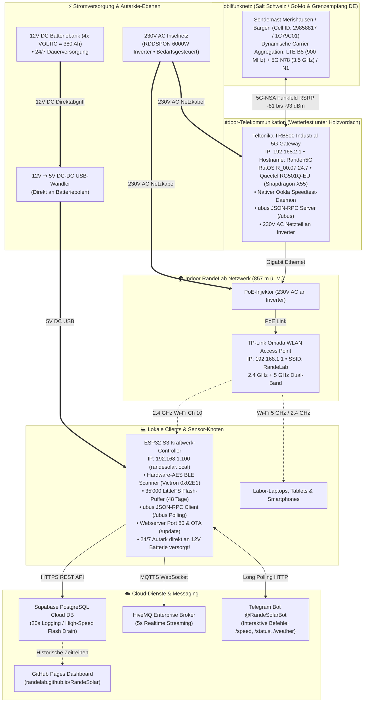
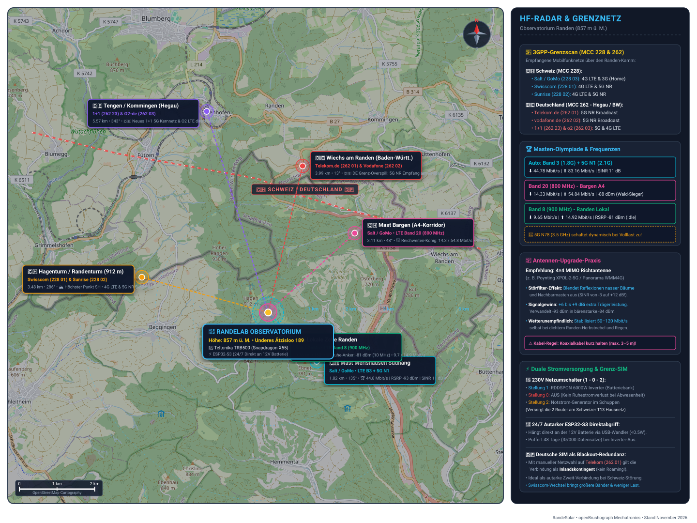
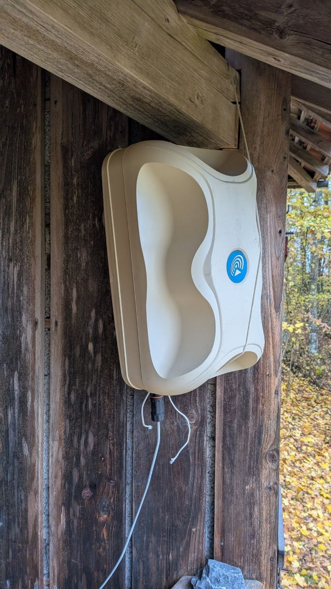
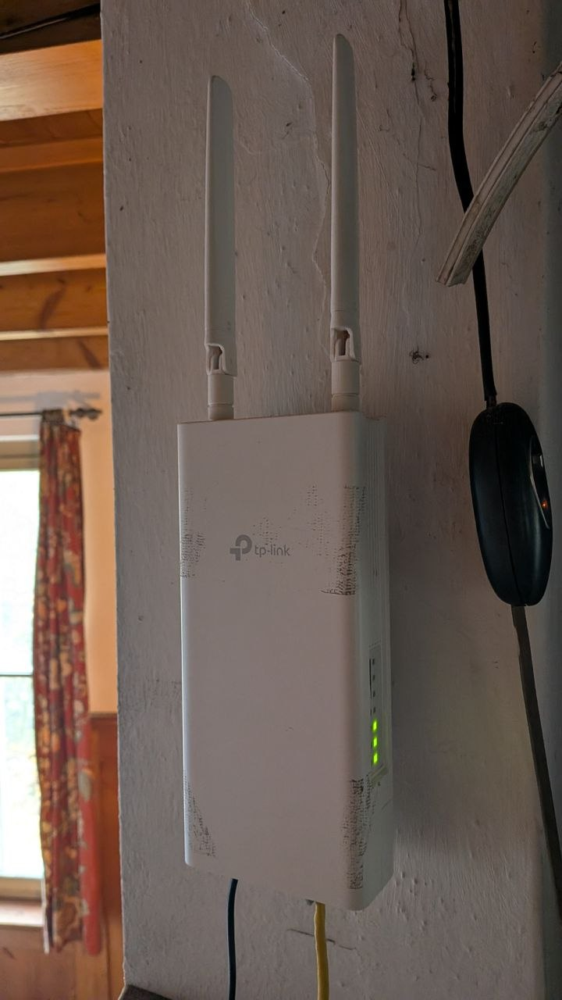
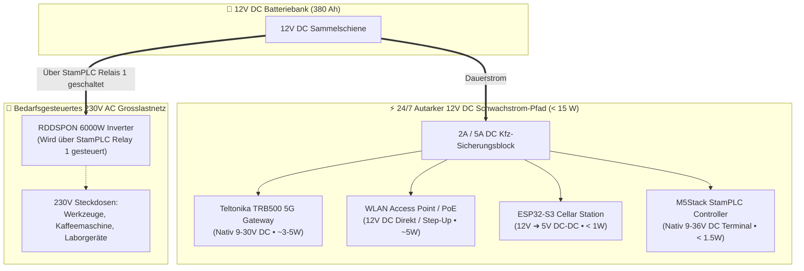

# 🌐 RandeLab 5G-Netzwerk- & Telekommunikations-Infrastruktur

**Standort:** RandeLab • Underes Ätzisloo 189, 8232 Merishausen / Randen  
**Koordinaten:** 47.7701° N, 8.5738° E • **857 m ü. M.** (Amtl. Gebäudeadresse GWR / Swisstopo)  
**Systemtyp:** Autonomes Dual-WAN / 5G-Mobilfunk-Inselnetzwerk mit ubus JSON-RPC Telemetrie  
**Stand:** November 2026  
**Schwesterdokument:** 👉 [**`SOLAR_SYSTEM_ARCHITECTURE.md`**](./SOLAR_SYSTEM_ARCHITECTURE.md) (PV-Kraftwerk, Batteriespeicher & 230V-Inverter)

---

## 1. Netzwerk-Topologie & Blockschaltbild

Das RandeLab verfügt über eine zweistufige Industrie-Netzwerkarchitektur. Die Trennung in ein wetterfestes Outdoor-5G-Gateway und einen geschützten Indoor-WLAN-Access-Point sorgt für optimale Funkfeldabdeckung und stabile Labor-Konnektivität:



### 1.1 Geographische HF-Topographie & OpenStreetMap Antennenkarte

Die folgende Vektorkarte kombiniert echte OpenStreetMap-Kartographie der Randen-Kammlage (**857 m ü. M.**) mit den exakt eingemessenen Mobilfunkmasten, Abstrahlvektoren, Entfernungen und Grenzfrequenzen (Schweiz 🇨🇭 &amp; Deutschland 🇩🇪):

[](./docs/maps/randen_rf_map.svg)

*Interaktive Vektorkarte in voller Auflösung öffnen: 👉 [**`docs/maps/randen_rf_map.svg`**](./docs/maps/randen_rf_map.svg) (oder als [PNG-Vorschau](./docs/maps/randen_rf_map.png))*  
*Ausführliche Masten-Tabelle, GPS-Koordinaten &amp; Detailanalyse: 👉 [**`docs/maps/README.md`**](./docs/maps/README.md)*

---

## 2. Fotodokumentation der Hardware vor Ort

| Outdoor 4G/5G Teltonika Gateway | Indoor TP-Link Omada WLAN-Router |
| :---: | :---: |
|  |  |
| *Wetterfeste Teltonika TRB500 Station (`192.168.2.1`) geschützt unter dem Holzvordach* | *TP-Link Access Point (`192.168.1.1`) mit PoE-Speisung im RandeLab-Innenraum* |

---

## 3. Technische Spezifikationen der Komponenten

### 3.1 Teltonika TRB500 (Industrial 5G Cellular Gateway)
* **Betriebssystem:** RutOS `R_00.07.24.7` (OpenWrt-basierte gehärtete Industrie-Firmware)
* **Mobilfunk-Modem:** **Quectel RG501Q-EU** (Qualcomm Snapdragon X55 5G Modem-RF System)
* **Architektur:** 5G NR NSA & SA (3GPP Release 15)
* **Theoretische Datenraten:** Bis zu 2.1 Gbit/s Download / bis zu 900 Mbit/s Upload
* **Schnittstellen:** 1× Gigabit Ethernet (RJ45), 4× SMA-Buchsen für externe 5G/LTE-MIMO-Antennen
* **IP-Adresse WAN-Gateway:** `192.168.2.1` (WebUI & ubus JSON-RPC auf Port 80/443)
* **Aktuelle Funkzelle (Live-Telemetrie):**
  * **Provider:** **GoMo (Salt Schweiz)**
  * **Cell ID:** `29858817` (TAC: `47007`, Physical Cell ID: `54`)
  * **Modus:** `5G-NSA` (Non-Standalone)
  * **Primärträger (4G-Anker):** **LTE Band 3 (1800 MHz)** • 20 MHz Kanalbandbreite
  * **Sekundärträger (5G-Zusatz):** **5G Band N1 (2100 MHz)** • 20 MHz Kanalbandbreite
  * **Modem-Betriebstemperatur:** ca. 24.0 °C – 28.0 °C

### 3.2 TP-Link Omada Access Point
* **Rolle:** Interner WLAN-Access-Point und Layer-2/3-Switch
* **IP-Adresse:** `192.168.1.1`
* **WLAN-SSID:** `RandeLab` (WPA2-PSK)
* **Stromversorgung:** Power over Ethernet (PoE) über Injektor
* **ESP32-Verbindung:** 2.4 GHz Wi-Fi (Kanal 10), Signalstärke: `-45 dBm bis -50 dBm` (100% Link-Qualität)

### 3.3 Stromversorgungs-Konzept: Duales 230V AC Netz (Umschalter Inverter ⟷ Generator) vs. 12V DC Direkt (ESP32)
Die Stromversorgung der Kommunikations- und Telemetrie-Infrastruktur ist architektonisch in zwei getrennte Ebenen unterteilt:

1. **Duales 230V AC Stromnetz (Schweizer Typ 13 / SEV 1011):**
   * Das **Teltonika TRB500 5G-Gateway** und der **TP-Link Omada Access Point** (via PoE-Injektor) hängen an der festen 230V-Gebäudeinstallation mit Schweizer T13-Steckdosen.
   * **Netz-Umschalter (1 - 0 - 2):** Über den großen manuellen Nockenschalter an der Wand kann das gesamte 230V-Netz umgeschaltet werden:
     * **Stellung 1 (Solar & Batterie):** Speisung über den RDDSPON 6000W Reinsinus-Wechselrichter aus der 12V-Batteriebank.
     * **Stellung 0 (AUS):** Allpolig getrennt (kein Ruhestromverlust von Inverter/Routern bei Abwesenheit).
     * **Stellung 2 (Notstrom-Generator):** Speisung über das **Benzin/Diesel-Aggregat im Schuppen** (für schwere Maschinen, Elektrowerkzeuge oder Winter-Notbetrieb).
   * Die beiden Router laufen somit vollautomatisch sowohl unter Solar-/Inverter-Strom (Stellung 1) als auch unter Generator-Strom (Stellung 2).
2. **12V DC Dauerspeisung (Autarker ESP32-S3):**
   * Der **ESP32-S3 Telemetrie-Controller** hängt **nicht** am 230V-Netz, sondern wird über einen **12V-zu-5V DC-DC USB-Wandler direkt an den 12V-Batteriepolen** betrieben.
   * *Verbrauch:* Mit < 0.5 Watt (ca. 100 mA @ 5V) ist der ESP32 für die 380 Ah Batteriebank vernachlässigbar klein.
   * *24/7 Autarkie:* Wird der 230V-Umschalter auf 0 gestellt, läuft der ESP32 unterbrechungsfrei weiter, lauscht per BLE auf den Victron MPPT 75|15 und zeichnet bis zu **48 Tage lang (35'000 Datensätze)** im Onboard-Flash auf. Sobald 230V (via Inverter oder Generator) wieder eingeschaltet wird und die Router booten, drainiert der ESP32 alle Daten lückenlos in die Cloud.

---

## 4. 5G Mobilfunk-Physik auf 857 m ü. M. im Randen-Wald

### 4.1 Die Live-HF-Metriken im Detail

Über die ubus-Schnittstelle liest der ESP32-S3 alle 60 Sekunden die echten Hochfrequenz-Messwerte des Modems aus:

| Parameter | Aktueller Live-Wert | Bewertung | Physikalische Bedeutung |
| :--- | :---: | :---: | :--- |
| **RSRP (Reference Signal Received Power)** | **`-93 dBm`** | **Sehr gut** | Die reine physikalische Trägerfeldstärke am Standort ist kräftig. Es gibt kein grundlegendes Signalproblem. |
| **SINR (Signal-to-Interference-plus-Noise)** | **`-3 dB bis -1 dB`** | **Mässig bis kritisch** | Das Rauschen/Störsignal überwiegt das Nutzsignal! Hauptursache für Geschwindigkeitsdrosselung. |
| **RSRQ (Reference Signal Received Quality)** | **`-14 bis -15 dB`** | **Befriedigend** | Zeigt an, dass der Funkkanal durch Nachbarzellen oder Reflexionen belegt ist. |
| **Signal Quality (RutOS)** | **`37% – 40%`** | **Solide** | Aggregierter Qualitätsindex des Quectel-Modems. |

### 4.2 Die Asymmetrie-Analyse: Warum 80 Mbit/s Upload, aber nur 20 Mbit/s Download?

Ein nativer Speedtest direkt vom Router sowie die Referenzmessung vom Laptop liefern verblüffende Messwerte:
* ⬇️ **Download:** **`20.24 – 22.21 Mbit/s`**
* ⬆️ **Upload:** **`78.33 – 80.56 Mbit/s`**

In 95% aller Internetanschlüsse ist der Download 5- bis 10-mal schneller als der Upload. Dass es am RandeLab **umgekehrt** ist (Upload fast viermal schneller als Download!), hat handfeste physikalische und netzwerktechnische Gründe:

1. **Kein Sendestärkeproblem des Standorts:**
   Da der Router Daten mit satten 80 Mbit/s zur Basisstation funken kann, ist die Sendeantenne und die Ausrichtung hervorragend.
2. **Mast-Downlink-Auslastung (Cell Congestion):**
   Auf dem Sendemast teilen sich alle angemeldeten Mobilfunkkunden denselben Download-Frequenzblock. Wenn Wanderer, Nachbardörfer oder andere Teilnehmer streamen, sinkt die Download-Bandbreite drastisch ein. Der Uplink hingegen wird von normalen Mobilfunknutzern kaum beansprucht und ist frei.
3. **Modulationsstufen & negativer SINR (`-3 dB`):**
   * Bei idealem Empfang (`SINR > +15 dB`) nutzt 5G die Modulationsstufe **256-QAM** (überträgt 8 Bit pro Symbol).
   * Sinkt der SINR wie am RandeLab auf **`-3 dB`**, muss das Modem im Downlink auf **16-QAM** oder **QPSK** (nur 2 bis 4 Bit pro Symbol) herunterschalten. Dadurch bricht der theoretische Durchsatz um mehr als 60% ein.
4. **Feuchtes Blätterdach & Reflexionen:**
   Der Randen ist dicht bewaldet. Die aktuell genutzten Frequenzen (1.8 GHz und 2.1 GHz) haben eine Wellenlänge von ca. 14–16 cm — genau in der Grössenordnung nasser Blätter und Äste. Diese wirken bei Regen und dichtem Hochnebel wie ein absorbierender und streuender Filter (*Multipath Fading*).

### 4.3 Dynamisches 5G-NSA Scheduling: Band 8 (900 MHz) vs. Band 3 (1800 MHz) & Band 78 (3.5 GHz)
Messungen im Live-Betrieb (November 2026) deckten das dynamische Band-Scheduling des Quectel RG501Q-EU Modems und der Salt-Basisstation auf:

* **Ruhemodus (Idle / Schwachlast):**
  * Das Modem wählt als Primärträger (`PCC`) bevorzugt **LTE Band 8 (900 MHz)** mit 10 MHz Kanalbandbreite (50 Resource Blocks).
  * *Grund:* Mit **`-81 dBm`** liefert das 900-MHz-Signal den stärksten RSRP-Signalpegel am Randen (durchdringt Wald und Kuppe mühelos).
  * *Durchsatz im Idle:* Limitiert auf ca. **`4.5 – 10 Mbit/s Down`** und **`11 – 15 Mbit/s Up`**.
* **Lastmodus (Ookla-Speedtest & Traffic-Wakeup):**
  * Sobald für mehrere Sekunden massiv Daten fliessen, schaltet die Basisstation sekundenschnell zusätzliche High-Speed-Träger per Carrier Aggregation (`SCC`) dazu:
    * **`SCC1`:** **`NR5G BAND 78`** (3.5 GHz C-Band Midband) oder **`NR5G BAND n1`** (2.1 GHz).
    * **`SCC2`:** **`LTE BAND 3`** (1800 MHz, 20 MHz Bandbreite).
  * *Spitzendurchsatz bei Carrier Aggregation:* **`44.78 Mbit/s Download`** / **`83.16 Mbit/s Upload`**!
  * Sobald der Datentransfer endet, baut die Zelle den 5G-Zusatzträger nach 1–2 Sekunden wieder ab, um Ressourcen und Energie zu sparen.

---

## 5. Speed-Tuning: Frequenzband- & Funkzellen-Optimierung

### 5.1 Praxisbericht & Feldversuch: Die „Band 8 Falle“ & Lösung durch manuelles Band-Locking (November 2026) 💡

Im Live-Laborbetrieb am Randen trat ein lehrreiches Phänomen auf, das die Tücken automatischer Mobilfunk-Algorithmen im Waldgebiet perfekt illustriert:

#### Das Problem: Unerwarteter Einbruch auf ~1.5 Mbit/s
Obwohl der Teltonika TRB500 guten Empfang (`58% Good`, RSRP `-81 dBm`) und `5G (NSA)` anzeigte, brach die gemessene Geschwindigkeit dramatisch ein:
* **Download:** nur noch **`1.53 – 2.47 Mbit/s`**
* **Upload:** nur noch **`5.41 – 13.66 Mbit/s`**
* **Carrier Aggregation:** **`Inactive`**

#### Warum ein Neustart (`Restart connection`) wirkungslos blieb:
Ein manueller Klick auf den blauen Button `Restart connection` im Statusmenü startete die Verbindung zwar in wenigen Sekunden neu, das Modem buchte sich aber **sofort wieder exakt in dieselbe langsame Verbindung ein**.

**Die HF-technische Ursache:**
1. **Wald-Durchdringung:** Das tiefe 900-MHz-Signal (LTE Band 8) durchdringt das dichte Laub und die Baumstämme mit minimaler Dämpfung. Es erreicht das RandeLab mit starken **`-81 dBm`**.
2. **Die Algorithmus-Falle:** Das automatische Zellwahlverfahren des Quectel RG501Q Modems sortiert die verfügbaren Zellen primär nach Signalstärke (RSRP). Da das schnellere 1800-MHz-Signal (Band 3) durch das feuchte Geäst stärker gedämpft wird (RSRP `-93 dBm`), stuft das Modem die 900-MHz-Zelle fälschlicherweise als „besser“ ein.
3. **Schmaler Flaschenhals:** Band 8 verfügt bei Salt nur über **10 MHz Kanalbandbreite** und unterstützt in dieser Zelle **kein Carrier Aggregation mit 5G**. Das gesamte Labor war auf diesem 10-MHz-Kanal gefangen.

#### Die Lösung: Manuelles Band-Locking im RutOS WebUI

Durch den gezielten Ausschluss von Band 8 wurde das Modem gezwungen, das etwas schwächere, aber viermal breitere 1800-MHz-Band mit 5G-Zusatzträger zu wählen.

**Genaue Schritt-für-Schritt-Anleitung in RutOS 7 (TRB500):**
1. WebUI aufrufen: `http://192.168.2.1` (Login: `admin`).
2. Im Menü links navigieren zu: **`Network` ➔ `Mobile` ➔ `Connection`**  
   *(Wichtig: Nicht unter Status suchen, sondern unter Network!)*
3. **Achtung Stolperfalle:** 
   * Zeile 2 ist `Preferred network type` (steht auf `5G/4G/3G auto` – so lassen!).
   * Zwei Zeilen darunter (Zeile 4) befindet sich das eigenständige Feld **`Band selection`**.
4. Dropdown **`Band selection`** von **`Auto`** auf **`Manual`** umstellen.
5. In der aufklappenden Frequenzband-Liste:
   * ❌ **Haken ENTFERNEN bei:** **`LTE B8`** (900 MHz) *(sperrt die langsame 10-MHz-Falle)*.
   * ✅ **Haken AKTIV LASSEN bei:** **`LTE B3`** (1800 MHz), **`LTE B1`** (2100 MHz) sowie 5G **`N1`** und **`N78`**.
6. Unten rechts auf den blauen Button **`Save & Apply`** klicken.

#### Das reale Messergebnis nach dem Band-Locking:

| Messwert / Parameter | Vorher (Automatisch auf Band 8) | **Nachher (Band-Locking auf B3 + 5G n1)** | Effekt |
| :--- | :---: | :---: | :---: |
| **Download** | `1.53 Mbit/s` | **`11.87 Mbit/s`** | **~8× schneller! 🚀** |
| **Upload** | `5.41 Mbit/s` | **`58.80 Mbit/s`** | **>10× schneller! ⚡** |
| **Carrier Aggregation** | *Inactive* | **`Active`** | **5G-Bündelung aktiv** |
| **Funkkanal-Bandbreite** | nur `10 MHz` | **`20 MHz + 20 MHz (40 MHz)`** | **4× mehr Funkspektrum** |
| **Verbundene Träger** | nur `LTE B8` | **`LTE B3 (1800) + 5G n1 (2100)`** | **Echtes 5G-NSA** |
| **Zellen-ID** | `30556191` (Zelle Randen B8) | **`23667202` (High-Capacity Mast)** | Starker Hauptmast |
| **Physical Cell ID (PCID)** | `107` | **`54 / 951` (Dual-Träger)** | Bündelung aktiv |

> [!TIP]
> **Erkenntnis für Off-Grid- & Waldstandorte:**  
> Bei Mobilfunk-Routern im Wald niemals blind auf „Auto-Band“ vertrauen! Niedrige Frequenzen (700–900 MHz) täuschen hervorragende Empfangsbalken vor, haben aber oft minimale Bandbreite und keine 5G-Bündelung. Manuelles Band-Locking auf mittlere Frequenzen (1800–2100 MHz) schaltet echte Carrier Aggregation frei und vervielfacht den Durchsatz.

---

### 5.2 Frequenzbänder von Salt Schweiz

Salt betreibt in der Schweiz folgende Mobilfunkbänder:

| Band | Frequenz | Typ | Eigenschaften auf dem Randen (857 m) |
| :--- | :--- | :--- | :--- |
| **B28 / N28** | **700 MHz** | 4G / 5G | **Extrem hohe Reichweite & Wald-Durchdringung.** Überwindet feuchtes Laub problemlos. Steigert den SINR oft auf über +10 dB! Bandbreite ca. 10–15 MHz. |
| **B20** | **800 MHz** | 4G (LTE) | Hohe Reichweite, exzellente Gebäudedurchdringung, 10 MHz Bandbreite. |
| **B8** | **900 MHz** | 4G (LTE) | Vorwiegend ländliche Grundversorgung. *Achtung: Automatische Falle am Randen, da ohne 5G-Bündelung!* |
| **B3** | **1800 MHz** | 4G (LTE) | *(Aktuell als Anker aktiv)* 20 MHz Bandbreite. Gute Standardkapazität, aber empfindlich für Laubdämpfung. |
| **B1 / N1** | **2100 MHz** | 4G / 5G | *(Aktuell als 5G aktiv)* 20 MHz Bandbreite (Re-Farmed 4G). |
| **B7** | **2600 MHz** | 4G (LTE) | Hohe Kapazität (20 MHz), schwache Durchdringung im Wald. |
| **N78** | **3500 MHz** | **5G NR (C-Band)** | **Echtes High-Speed-5G.** 70 bis 100 MHz Bandbreite! Ermöglicht **150 bis 400+ Mbit/s**, benötigt aber Sichtverbindung. |

### 5.3 Strategie 1: 5G N78 (3.5 GHz) erzwingen
* **Ziel:** Prüfen, ob der erreichbare Salt-Mast über Band N78 verfügt.
* **Vorgehen:** In RutOS unter *Band Selection* alle 5G-Bänder ausser **N78** deaktivieren.
* **Ergebnis:** Falls N78 empfangbar ist, steigt der Download typischerweise sofort über **100 Mbit/s**. Falls kein Empfang besteht, bucht sich der Router nicht ein (Fallback auf Auto).

### 5.4 Strategie 2: Tiefe Frequenzbänder als 4G-Anker erzwingen (B28 / B20)
* **Ziel:** Den negativen Störabstand (`SINR = -3 dB`) beseitigen.
* **Vorgehen:** LTE Band 3 abwählen und stattdessen **Band 28 (700 MHz)** oder **Band 20 (800 MHz)** als primäres LTE-Band vorgeben.
* **Physikalischer Effekt:** Die 700-MHz-Wellen dringen durch das nasse Blätterdach des Randen fast ohne Streuung hindurch. Der SINR kann auf positive Werte (+5 bis +15 dB) klettern, wodurch fehlerhafte Paketwiederholungen entfallen.

### 5.5 Strategie 3: Cell-Locking (Bindung an alternativen Mast)
Auf dem Randen sind je nach Antennenausrichtung mehrere Masten sichtbar:
* Mast Merishausen Dorf
* Mast Bargen / Schlauch
* Mast Randenturm / Hagenturm
* Masten Richtung Herblingen / Schaffhausen

Wenn der aktuell genutzte Mast überlastet ist, kann über AT-Befehle (`AT+QNWLOCK="common/4g",...`) oder die RutOS-Zellensperre eine feste Bindung an einen weniger frequentierten Nachbarmasten konfiguriert werden.

### 5.6 Antennen-Upgrade-Guide: Welche Außenantenne lohnt sich am Randen? (In einfacher Sprache)

Aktuell nutzt der TRB500 vier kleine schwarze Standard-Stummelantennen direkt am Gehäuse unter dem Holzvordach. Das reicht für eine Grundverbindung, aber bei nassen Bäumen im Herbst streut das Signal. Folgende Antennen-Optionen stehen zur Wahl:

1. **Option A: 4×4 MIMO Richtantenne (Dringend empfohlen! z. B. *Poynting XPOL-2-5G* oder *Panorama WMM4G*):**
   * **Was ist das?** Ein wetterfestes, weißes Flachpaneel (ca. 35 × 35 cm), das außen an der Dachkante oder an einem kleinen Mast montiert wird. Es enthält vier getrennte Antennenelemente in einem Gehäuse und wird mit 4 SMA-Kabeln an den TRB500 angeschlossen.
   * **Wie funktioniert es?** Eine Richtantenne fokussiert wie ein Scheinwerfer in eine ganz bestimmte Richtung (z. B. direkt zum Sendemast Merishausen Südhang oder Bargen).
   * **Vorteile am Randen:**
     * **Filtert Störungen aus:** Weil sie nur nach vorne "schaut", blendet sie Reflexionen und das Rauschen anderer Masten aus. Der Störabstand (`SINR`) steigt typischerweise von **`-3 dB`** auf **`+10 bis +15 dB`**.
     * **Signalgewinn (+6 bis +9 dBi):** Macht aus einem schwachen Signal (`-95 dBm`) ein stabiles, kräftiges Signal (`-85 dBm`).
     * **Ergebnis:** Massiv stabilerer Download (50–120 Mbit/s auch bei strömendem Regen oder dichtem Nebel).
2. **Option B: 4×4 MIMO Rundstrahlantenne (Omni, z. B. *Poynting OMNI-493* oder *Teltonika PR1KCO28*):**
   * **Was ist das?** Ein weißer Stab bzw. Zylinder, der Signale aus allen 360°-Richtungen gleichmäßig auffängt.
   * **Vorteil:** Man muss sie nicht auf einen bestimmten Mast ausrichten.
   * **Nachteil am Randen:** Da sie aus allen Richtungen empfängt, fängt sie auch mehr Störfeuer und Reflexionen der nassen Bäume ein. Der SINR verbessert sich deutlich weniger als bei einer Richtantenne.
3. **Praxis-Tipp zur Verkabelung:** Wenn eine externe Antenne montiert wird: Die 4 Koaxialkabel so kurz wie möglich halten (max. 3–5 Meter dämpfungsarmes HDF/LMR-200 Kabel), da lange Kabel bei hohen 5G-Frequenzen (2.1 GHz und 3.5 GHz) Signalstärke vernichten.

---

### 5.7 Provider-Optionen & Grenzfunk: Swisscom vs. Deutsche SIM (Was würde ein Wechsel bedeuten?)

Da das RandeLab auf **857 m ü. M.** oben auf der Hügelkuppe thront, liegt es in einem extrem spannenden HF-Korridor. Der 3GPP-Scan zeigt, dass sowohl das Schweizer Kernnetz als auch deutsche Sender direkt empfangen werden:

#### Option 1: Wechsel zu Swisscom (oder Wingo / Coop Mobile)
* **Aktuelle Empfangslage:** Im RandeLab empfängt der TRB500 von **Swisscom (`228 01`)** sowohl **4G LTE** als auch **5G NR** mit hervorragendem Pegel.
* **Was bringt Swisscom in der Praxis?**
  * **Größere Frequenzpakete & weniger Überlastung:** Swisscom verfügt in ländlichen Regionen oft über mehr aggregierte Frequenzbänder (inkl. dediziertem 5G Standalone SA und Band N78) und betreibt weniger überbuchte Downlink-Kanäle als Discount-Netze.
  * **Höhere Download-Stabilität:** Oftmals 80 bis 200 Mbit/s Download, wo Discount-Netze bei Spitzenzeiten auf 5–10 Mbit/s einbrechen.
* **Was müsste man tun?**
  1. Swisscom- bzw. Wingo-SIM-Karte in den TRB500 einlegen.
  2. Im RutOS-Webinterface (`192.168.2.1`) unter *Network → Interfaces → Mobile* den APN auf `gprs.swisscom.ch` (bzw. für Wingo `internet`) setzen.
  3. Der ESP32-S3 liest den neuen Betreibernamen (`Swisscom`) über die `ubus`-Schnittstelle vollautomatisch aus – es ist **kein Code-Update auf dem ESP32 nötig**!

#### Option 2: Nutzung einer deutschen SIM-Karte (Telekom Deutschland, Vodafone, 1+1, O2)
* **Aktuelle Empfangslage:** Unser Grenzscan beweist: Auf dem Randen empfängt der TRB500 direkt **Telekom.de (5G NR)**, **vodafone.de (5G NR)** und **1+1 (4G/5G)** über die Hügelzüge aus Baden-Württemberg (Hegau / Schwarzwald-Baar-Kreis)!
* **Was bedeutet das technisch & tariflich?**
  * **Echte Landes- und Infrastruktur-Redundanz:**
    Sollte im Schweizer Mobilfunknetz eine Störung auftreten oder der Talmast in Merishausen bei einem Sturm ausfallen, läuft das RandeLab über die deutschen Masten völlig unabhängig weiter.
  * **Tarif-Besonderheit (Kein Roaming, sondern Heimatnetz!):**
    Wenn eine deutsche SIM-Karte im TRB500 steckt und der Router im Menü fest auf den Netzcode **`262 01` (Telekom Deutschland)** eingestellt wird (*Network → Mobile → Network Operators → Manual*), bucht sich das Modem direkt als **Inlands-Teilnehmer** in die deutsche Zelle ein. Es fällt **kein Roaming** an, und man nutzt das reguläre deutsche Inlands-Datenvolumen (z. B. unbegrenzte deutsche Telekom- oder O2-Flatrate)!
  * **Signalstärke & Antennen-Bedarf:**
    Da die deutschen Masten weiter entfernt liegen (Luftlinie ca. 5–12 km im Hegau / Tengen / Wiechs am Randen), ist das Signal mit den internen Stummelantennen schwächer. Für einen stabilen Dauerbetrieb mit einer deutschen SIM empfiehlt sich dringend eine **4×4 MIMO Richtantenne (Option A)**, die nach Norden / Nordosten Richtung Grenze ausgerichtet wird.

---

## 6. Teltonika `ubus` JSON-RPC Schnittstelle des ESP32

Der ESP32-S3 kommuniziert autonom im LAN mit dem Teltonika TRB500 über das OpenWrt `ubus` JSON-RPC Protokoll.

### 6.1 Authentifizierung & Token-Handling (`session.login`)
* **Endpoint:** `POST http://192.168.2.1/ubus`
* **Payload:**
  ```json
  {
    "jsonrpc": "2.0",
    "id": 1,
    "method": "call",
    "params": [
      "00000000000000000000000000000000",
      "session",
      "login",
      { "username": "admin", "password": "<PASSWORT>" }
    ]
  }
  ```
* **Token-Lebensdauer:** Das Gateway liefert eine `ubus_rpc_session` (300 s Gültigkeit). Der ESP32 cached den Token für **240 Sekunden (4 Minuten)** im RAM und erneuert ihn automatisch.

### 6.2 HF-Telemetrie-Abfrage (`gsm.modem0 -> info`)
* **Payload:**
  ```json
  {
    "jsonrpc": "2.0",
    "id": 2,
    "method": "call",
    "params": ["<TOKEN>", "gsm.modem0", "info", {}]
  }
  ```
* **Ausgelesene Felder:** `rsrp_value`, `sinr_value`, `rsrq_value`, `signal_quality_value`, `net_mode_str`, `band_str`, `provider_name`, `reg_ci`, `temperature`.

### 6.3 Nativer Ookla-Speedtest (`speedtest -> run`)
* **Hintergrund:** Frühere Speedtests wurden direkt auf dem ESP32 über HTTP-Downloads ausgeführt. Wegen des kleinen TCP-Fensters (`TCP_WND = 5744 Bytes`) und des Bandwidth-Delay-Products konnte der ESP32 bauartbedingt nie mehr als 2 bis 4 Mbit/s verarbeiten.
* **Lösung:** Der ESP32 triggert den echten Ookla-Speedtest direkt auf dem Teltonika-Gateway:
  ```json
  {
    "jsonrpc": "2.0",
    "id": 4,
    "method": "call",
    "params": ["<TOKEN>", "speedtest", "run", {}]
  }
  ```
* **Ergebnisauswertung:** Der Router legt das Resultat in `/tmp/speedtest.json` ab:
  ```json
  {
    "serverURL": "ookla.wwz.ch",
    "startTime": 1794064349,
    "avgDownloadSpeed": 2530000,
    "avgUploadSpeed": 10070000,
    "state": "FINISHED"
  }
  ```
* **Umrechnung im ESP32:**
  $$\text{Download Mbit/s} = \frac{\text{avgDownloadSpeed (Bytes/s)} \times 8}{1'000'000} \approx \mathbf{20.24\text{ Mbit/s}}$$
  $$\text{Upload Mbit/s} = \frac{\text{avgUploadSpeed (Bytes/s)} \times 8}{1'000'000} \approx \mathbf{80.56\text{ Mbit/s}}$$

### 6.4 Grenznetz- & Auslands-Operator-Scan (`AT+COPS=?`)
Auf der Kammlage des Randens (**857 m ü. M.**) reicht der optische und funktechnische Horizont bis weit in den deutschen Hegau und das Bundesland Baden-Württemberg. Über das CLI-Diagnosetool `scripts/chabis_scanner.py` kann ein 3GPP-Frequenzscan über alle sichtbaren Mobilfunkanbieter durchgeführt werden:

| Land | Netzbetreiber | MCC / MNC | Funktechnik (RAT) | Status am Randen (857 m ü. M.) |
| :--- | :--- | :---: | :---: | :--- |
| 🇨🇭 **Schweiz** | **Sunrise** | `228 02` | **4G LTE & 5G NR** | Sichtbar / Broadcast |
| 🇨🇭 **Schweiz** | **Swisscom** | `228 01` | **4G LTE & 5G NR** | Sichtbar / Broadcast |
| 🇨🇭 **Schweiz** | **Salt / GoMo** | `228 03` | **4G LTE & 3G UTRAN** | **Aktiv eingebucht / Home Network** |
| 🇩🇪 **Deutschland** | **Telekom.de** | `262 01` | **5G NR** | Sichtbar / Grenzüberschreitender Overspill |
| 🇩🇪 **Deutschland** | **vodafone.de** | `262 02` | **5G NR** | Sichtbar / Grenzüberschreitender Overspill |
| 🇩🇪 **Deutschland** | **1+1** | `262 23` | **4G LTE & 5G NR** | Sichtbar / Neues 5G-Kernnetz DE |

> [!NOTE]
> Dieser Scan belegt das enorme Potenzial des Standorts als grenzüberschreitendes Hochfrequenz- und Telekommunikations-Observatorium. Bei Ausfall der Schweizer Infrastruktur könnte das Gateway im Notfall auf deutsches Roaming umschalten.

---

## 7. ESP32-S3 Offline-Resilienz: 35'000-Datensatz-Flash-Puffer

Sollte die 5G-Verbindung bei extremem Unwetter oder Netzausfall abreissen, verliert das System **keinen einzigen Messpunkt**:

* **Speichermedium:** Onboard SPI-Flash (LittleFS Dateisystem, partitioniert auf dem 8 MB ESP32-S3).
* **Kapazität:** Bis zu **35'000 vollständige Datensätze**.
* **Autonomie-Dauer:** Bei einem 2-Minuten-Aufzeichnungsintervall reicht der Puffer für:
  $$\frac{35'000 \times 2\text{ Min}}{60\text{ Min} \times 24\text{ h}} = \mathbf{48.6\text{ Tage vollständige Offline-Autarkie!}}$$
* **Ringpuffer-Schutz:** Erreicht der Puffer das Limit, werden die ältesten 100 Datensätze kontrolliert freigegeben (*FIFO Ringbuffer*).
* **High-Speed-Drain:** Sobald die 5G-Verbindung wieder stabil steht, pumpt der ESP32 bis zu 250 gepufferte Datensätze pro Zyklus im Batch nach Supabase.
* **Manueller Datenexport:** Unabhängig von der Cloud kann der Puffer jederzeit als CSV-Datei direkt vom ESP32 im LAN heruntergeladen werden:
  `http://randesolar.local/api/buffer/csv`

---

## 8. Mögliche & geplante Optimierung: 12V DC Direktversorgung für 5G-Gateway & WLAN-Router

### 8.1 Das aktuelle Dilemma (230V AC Abhängigkeit)
Momentan werden das Outdoor 5G-Gateway (Teltonika TRB500) und der Indoor WLAN-Access-Point (TP-Link Omada) über standardmässige 230V-Steckdosen-Netzteile betrieben, welche am **RDDSPON 6000W Inverter** hängen:

```
[12V Batteriebank] ➔ [6000W Inverter (25-40W Idle)] ➔ [230V AC Netz] ➔ [Steckernetzteile] ➔ [12V Router]
```

**Problematik im aktuellen Inselbetrieb:**
1. **Der 6000W-Wechselrichter muss 24/7 durchlaufen:**
   Nur um das 5G-Modem (~3–5 W) und den WLAN-AP (~5–7 W) zu versorgen, verbraucht der Wechselrichter im puren Leerlauf **25 W bis 40 W Dauerlast**. Das entspricht **600 Wh bis 960 Wh pro Tag**, rein für die Bereitstellung der 230V-Netzspannung!
2. **Die «WLAN-Blindheits-Falle» (Deadlock bei Inverter-Abschaltung):**
   Wird der Inverter zum Schutz der Batterie (z.B. bei drohender Tiefentladung $<11.8\,\text{V}$ oder nachts per StamPLC-Relais) abgeschaltet, bricht sofort die 230V-Versorgung zusammen. **Das gesamte RandeLab-WLAN und der 5G-Internet-Uplink sterben augenblicklich ab**.
   * Die StamPLC kann die Cellar-Station (`randesolar.local`) nicht mehr abfragen.
   * Das Web-Dashboard (`stamplc.local`) kann vom Smartphone/Laptop nicht mehr geöffnet werden, um den Inverter wieder einzuschalten.
   * Telemetrie, Supabase und Telegram-Warnungen fallen aus.

---

### 8.2 Die Lösung: Direkter 12V DC Abgriff an der Batteriebank

Sowohl das **Teltonika TRB500** als auch gängige WLAN-Router/PoE-Injektoren sind industriell oder nativ für Niedervolt-Gleichstrom ausgelegt:

* **Teltonika TRB500:** Besitzt einen Weitbereichs-Gleichstromeingang von **9 V bis 30 V DC** über den 4-Pin-Industriestecker (oder DC-Hohlstecker). Es verfügt über ein internes Schaltnetzteil und kann **ohne jeden Zwischenwandler direkt an die 12V-Batteriebank** geklemmt werden (abgesichert mit einer 2A-Schmelzsicherung).
* **WLAN Access Point:** Kann entweder über einen 12V-Direktanschluss oder einen kompakten DC-DC-Schrittwandler (z.B. 12V auf 24V/48V Passive-PoE-Injektor) betrieben werden.



---

### 8.3 Quantitativer Energie- & Autarkievergleich

| Kennwert | Status Quo (230V über Inverter) | 12V DC Direktversorgung (Ziel) | Einsparung / Vorteil |
| :--- | :--- | :--- | :--- |
| **Inverter-Status** | Muss **24/7/365** laufen | Läuft **nur bei echtem 230V-Bedarf** | Schont Elektronik & Batterien |
| **Standby-Dauerleistung** | **35 W – 50 W** (Inverter + Netzteile) | **8 W – 12 W** (TRB500 + AP + ESPs) | **$\mathbf{\approx 75\%}$ weniger Dauerlast!** |
| **Täglicher Grundverbrauch** | **$\approx 850 - 1'200\text{ Wh/Tag}$** | **$\approx 200 - 280\text{ Wh/Tag}$** | **$\mathbf{650 - 900\text{ Wh/Tag}}$ gespart!** |
| **Winter-Autarkie (November)** | 1.5 bis 2.5 Tage bis Tiefentladung | **8 bis 14 Tage autark** ohne Solar! | Faktor $5\times$ höhere Überlebenszeit |
| **Netzwerk bei Inverter-Aus** | ❌ **Totalausfall** (kein WLAN, kein 5G) | ✅ **100% Online** (WLAN, 5G, Telemetrie laufen) | Kein Deadlock, volle Kontrolle |
| **Remote-Reaktivierung** | ❌ Unmöglich (Router tot) | ✅ Jederzeit per Handy/Web/StamPLC schaltbar | Inverter kann remote geweckt werden |

---

### 8.4 Umsetzungsschritte für RandeLab
1. **Material:** 1× Kfz-Flachsicherungshalter (z.B. 4-fach Block mit 2A/3A Sicherungen), 1× Teltonika 4-Pin-Stromkabel (oder 5.5×2.1 mm DC-Hohlstecker), 1× 12V Passive-PoE-Injektorkabel.
2. **Anschluss:** Abgriff direkt am 12V-DC-Verteilerblock der Batteriebank hinter der Hauptsicherung.
3. **Ergebnis:** Der 6000W-Wechselrichter kann den ganzen Winter über nachts oder bei Abwesenheit schlafen. Das RandeLab bleibt über 5G und WLAN permanent erreichbar, sendet lückenlose Telemetrie und kann bei Bedarf über das StamPLC-Relais jederzeit aufgeweckt werden.

---

## 9. Verlinkung & Referenzen

* 👉 **Solar-Kraftwerk, Batteriespeicher & 230V-Inverter:** [**`SOLAR_SYSTEM_ARCHITECTURE.md`**](./SOLAR_SYSTEM_ARCHITECTURE.md)
* 👉 **Projekt-Hauptseite & Flash-Anleitung:** [**`README.md`**](./README.md)
* 👉 **Globales Web-Dashboard:** [**`randelab.github.io/RandeSolar`**](https://randelab.github.io/RandeSolar/)
* 👉 **Lokale ESP32-Webstation:** [**`http://randesolar.local`**](http://randesolar.local)
