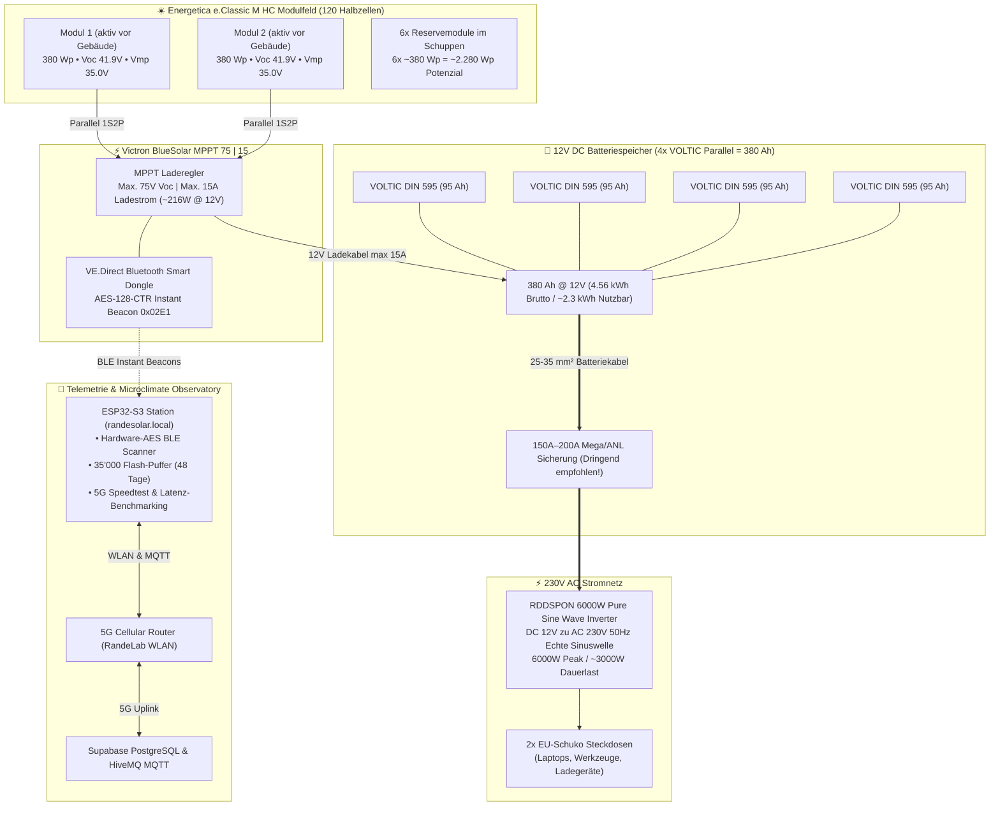
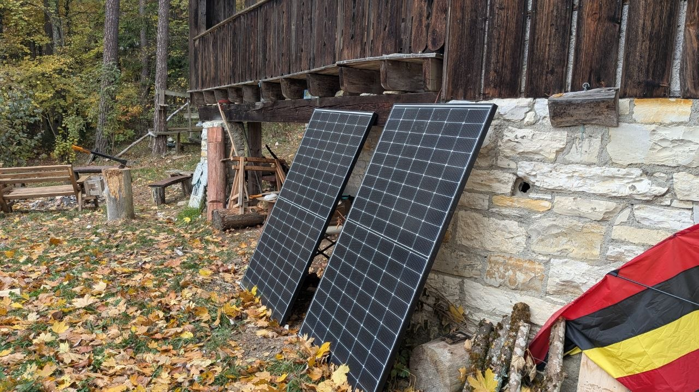
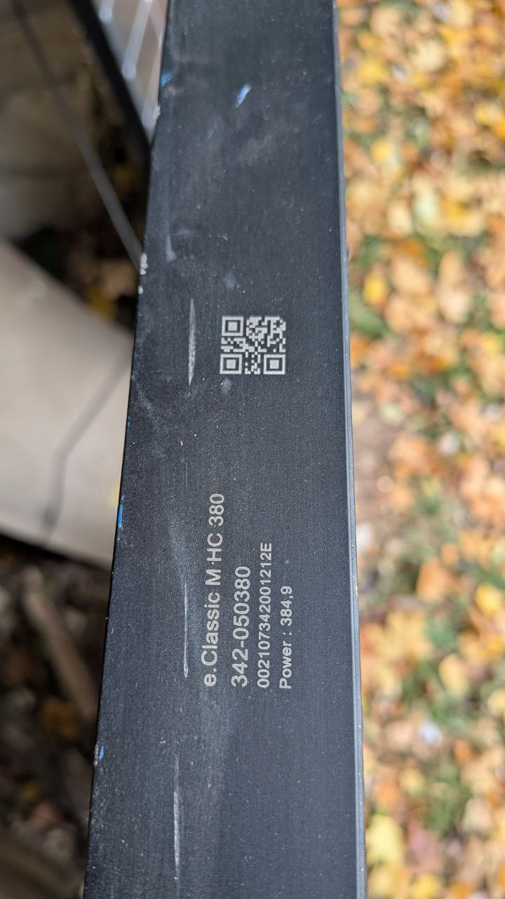
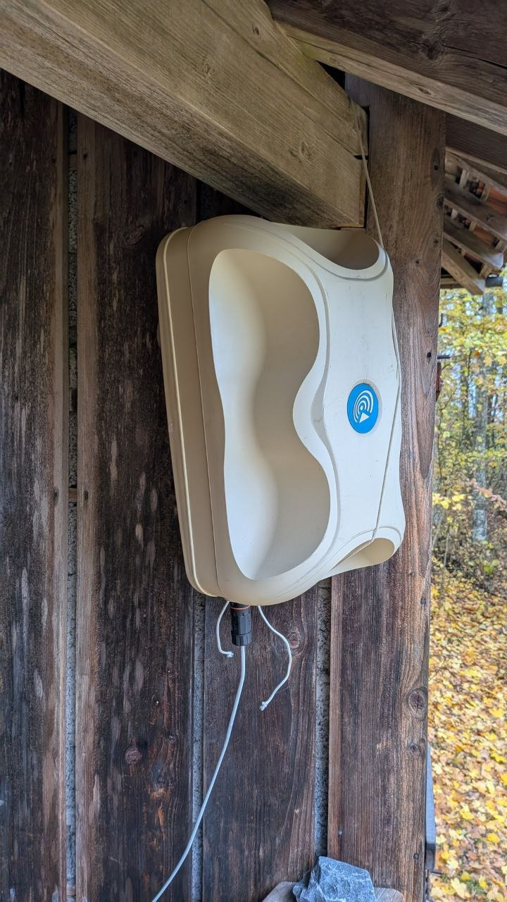
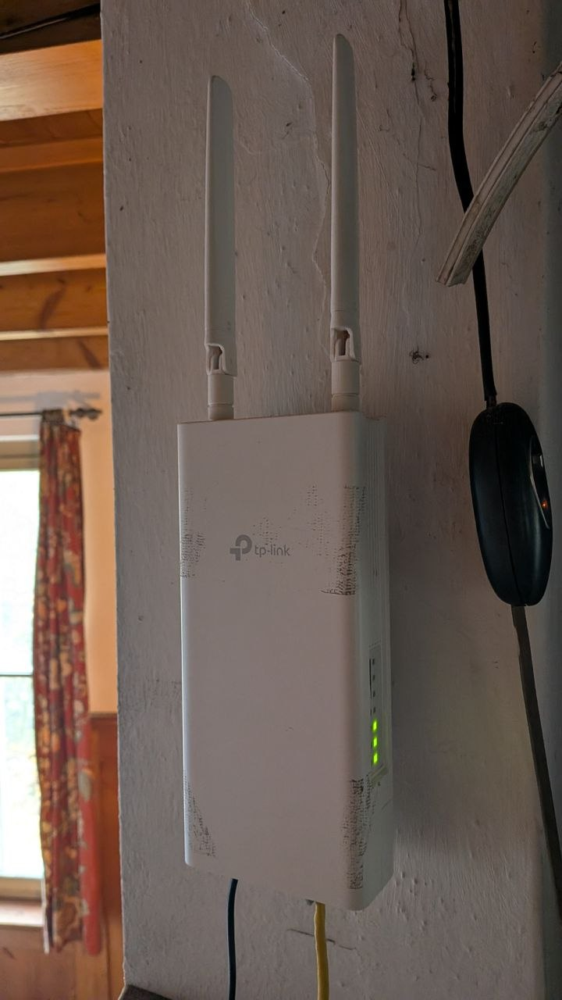
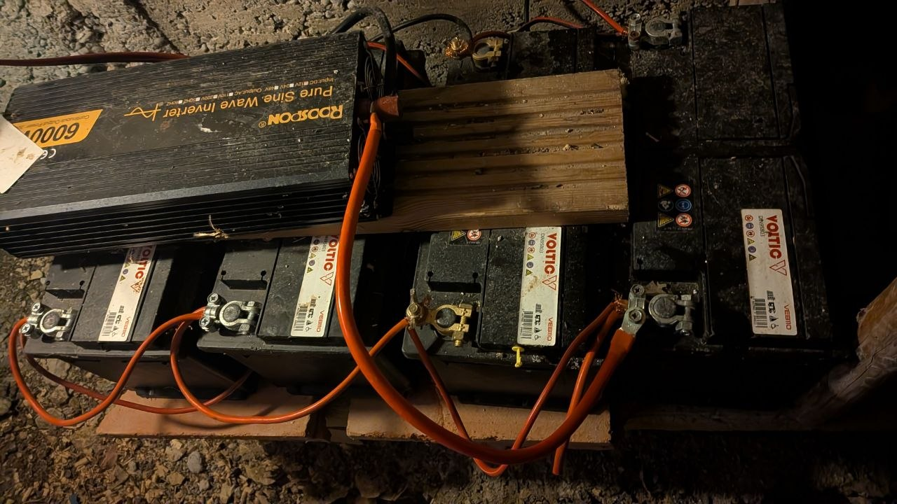

# ☀️ RandeSolar Systemarchitektur & Auslegungsdokumentation

**Standort:** RandeLab • Underes Ätzisloo 189, 8232 Merishausen / Randen  
**Koordinaten:** 47.7701° N, 8.5738° E • **857 m ü. M.** (Amtl. Gebäudeadresse GWR / Swisstopo)  
**Systemtyp:** Autonomes Off-Grid Solar-Inselnetz mit 12V-Batteriespeicher & 230V-Wechselrichter  
**Stand:** November 2026  
**Schwesterdokument:** 👉 [**`NETWORK_5G_INFRASTRUCTURE.md`**](./NETWORK_5G_INFRASTRUCTURE.md) (5G Gateway, ubus API, Band-Locking & Wi-Fi)

---

## 1. Systemübersicht & Blockschaltbild

---

## 2. Fotodokumentation & Feldeinsatz vor Ort

### 2.1 Photovoltaik-Feld & Modulkennzeichnung
Die beiden aktuell aktiven Module sind an der Naturstein- und Holzwand des RandeLabs Richtung Süd aufgestellt. Die e.ISP®-Halbzellentechnologie sorgt dafür, dass selbst bei teilweisem Schattenwurf durch die Balkonbalken oder umstehende Bäume der restliche Modulteil ungestört weiterproduziert:

| Aktuelles 2-Panel Setup (1S2P) | Typenschild & Kalibrierungs-Laserung |
| :---: | :---: |
|  |  |
| *Zwei Energetica e.Classic M HC Module an der RandeLab-Wand* | *Laser-Typenschild: 380er Klasse, Flash-Test 384,9 Wp!* |

### 2.2 Internet-Infrastruktur & Mobilfunk-Gateway
Die Telemetrie-Übertragung ins Internet und das ESP32-WLAN werden über ein zweistufiges professionelles Netzwerk-Setup realisiert:

* **Outdoor 5G Gateway (`192.168.2.1`):** **Teltonika TRB500** (Hostname `Randen5G`, RutOS R_00.07.24.7), industrielles 5G-Gateway im wetterfesten Schutzgehäuse unter dem Holzvordach.
  * **5G-Modem:** Quectel RG501Q-EU (Qualcomm Snapdragon X55)
  * **Provider & Netz:** **GoMo (Salt Schweiz)**, 5G-NSA (Non-Standalone) mit Carrier Aggregation
  * **Funkzelle:** Cell ID `29858817` (TAC: `47007`, PCID: `54`)
  * **Primärband (4G-Anker):** **LTE Band 3 (1800 MHz)** • 20 MHz Bandbreite • RSRP `-93 dBm` • RSRQ `-13 dB`
  * **Sekundärband (5G):** **5G Band N1 (2100 MHz)** • 20 MHz Bandbreite • RSRP `-106 dBm` • SINR `-3 dB`
* **Indoor WLAN Access Point (`192.168.1.1`):** **TP-Link Omada Access Point**, per PoE versorgt, spannt das interne RandeLab-WLAN auf und verbindet den ESP32-S3 (`192.168.1.100`) mit dem Teltonika-Gateway.

#### Physikalische Erklärung: Mikroklima vs. Internet-Geschwindigkeit 🌧️🌲
Die Live-Abfrage des Teltonika-Gateways bestätigt den direkten Einfluss des Randen-Wetters auf die Mobilfunkleistung:
1. **Frequenzdämpfung:** Die Verbindung nutzt 1.8 GHz (B3) und 2.1 GHz (N1). Diese Frequenzen reagieren empfindlich auf Wassertröpfchen in der Luft (dichter Hochnebel, Regen) und besonders auf das umgebende **nasse Blätterdach des Waldes**, welches wie ein absorbierender Schirm wirkt.
2. **Signal-Rauschabstand (SINR):** Bei feuchtem Herbstwetter sinkt der Störabstand auf **`SINR = -3 dB`** ab. Das Rauschen überwiegt, das Modem muss Pakete wiederholen (*Retransmissions*), wodurch der Durchsatz auf 1.5 – 5 Mbit/s sinkt.
3. Bei trockener, klarer Witterung steigt der SINR in den positiven Bereich (+5 bis +15 dB), und die Datenraten verdoppeln bis vervierfachen sich.

| Outdoor 4G/5G Teltonika Gateway | Indoor TP-Link Omada WLAN-Router |
| :---: | :---: |
|  |  |
| *Wetterfeste Teltonika 4G/5G Station (192.168.2.1) geschützt unter dem Holzvordach* | *TP-Link Access Point (192.168.1.1) mit PoE-Speisung im RandeLab-Innenraum* |

> [!NOTE]
> Ausführliche Details zu den Hochfrequenz-Messwerten, Band-Locking (700 MHz / 3.5 GHz N78), der ubus-API-Architektur und der Asymmetrie-Analyse (80 Mbit/s Up vs. 20 Mbit/s Down) sind im separaten Dokument dokumentiert:  
> 👉 [**`NETWORK_5G_INFRASTRUCTURE.md`**](./NETWORK_5G_INFRASTRUCTURE.md)

### 2.3 Batteriespeicher (4x VOLTIC) & RDDSPON 6000W Inverter
Die 4 VOLTIC Batterien (DIN 595, je 95 Ah) sind parallel geschaltet und bilden eine massive 380 Ah Pufferbank (4.56 kWh Bruttospeicher). Darauf montiert sitzt der RDDSPON 6000W Reinsinus-Wechselrichter:

| 4-fach Batteriebank & 6000W Inverter |
| :---: |
|  |
| *4x VOLTIC DIN 595 parallel (380 Ah @ 12V) mit RDDSPON 6000W Pure Sine Wave Inverter* |

---

## 3. Technische Daten der Module: Energetica e.Classic M HC

Laut offiziellem Datenblatt (**Energetica Photovoltaic Industries GmbH**, Liebenfels, Österreich):

| Parameter | Wert (STC: 1000 W/m², 25°C) | Wert (NMOT: 800 W/m², 20°C, 1 m/s) |
| :--- | :--- | :--- |
| **Nennleistung ($P_{max}$)** | **365 Wp – 390 Wp** (typ. ~380 Wp) | 274 Wp – 292 Wp |
| **Leerlaufspannung ($V_{oc}$)** | **41.17 V – 41.93 V** | 38.88 V – 39.60 V |
| **Arbeitspunktspannung ($V_{mpp}$)** | **34.37 V – 35.03 V** | 32.44 V – 33.06 V |
| **Arbeitspunktstrom ($I_{mpp}$)** | **10.67 A – 11.16 A** | 8.45 A – 8.84 A |
| **Kurzschlussstrom ($I_{sc}$)** | **11.26 A – 11.95 A** | 8.90 A – 9.45 A |
| **Zellentechnologie** | 120 monokristalline PERC Halbzellen | 12-Busbar Technologie |
| **Verschattungsschutz** | e.ISP® integrierte Elektronik auf Strang-Ebene | Verhindert Hotspots |
| **Abmessungen & Gewicht** | 1780 × 1042 × 36 mm • **21 kg** | Aluminiumrahmen schwarz |
| **Temperaturkoeffizient ($V_{oc}$)**| **$-0.26\% / \text{K}$** | Spannung steigt bei Kälte! |

---

## 4. Kritische Auslegungsgrenzen für den Victron MPPT 75 | 15

### 4.1 Die 75V-Spannungsgrenze (Zerstörungsgefahr!)
* **Max. zulässige PV-Leerlaufspannung am Regler:** **75 V**
* **1 Modul:** $V_{oc} = 41.93\text{ V}$ $\rightarrow$ **Sicherer Betrieb** ($41.93\text{ V} \ll 75\text{ V}$)
* **2 Module in Reihe:** 
  $$V_{oc} (25^\circ\text{C}) = 41.93\text{ V} \times 2 = \mathbf{83.86\text{ V}} > 75\text{ V} \quad \text{⛔ VERBOTEN!}$$
  Bei $-15^\circ\text{C}$ im Randen-Winter:
  $$V_{oc} (-15^\circ\text{C}) = 83.86\text{ V} \times [1 + (-0.0026) \times (-40)] \approx \mathbf{92.6\text{ V}}!$$
  > **Ergebnis:** Zwei dieser Module in Serie zerstören die Eingangsstufe des Victron 75|15 unweigerlich. Die Module dürfen an diesem Regler **ausschliesslich parallel (1S)** betrieben werden!

### 4.2 Die 15A-Ladestromgrenze bei 12V
* **Max. Ladestrom in den Akku:** $15\text{ A}$
* **Max. Ladeleistung:** $15\text{ A} \times 14.4\text{ V} \approx \mathbf{216\text{ W}}$
* **Aktuelles Setup (2 Module parallel = ~760 Wp):**
  * **Volle Sonne:** Der MPPT regelt sauber auf 15 A ab (*Clipping*). Dem Regler schadet das nicht, er nimmt sich nur den Strom, den er verarbeiten kann.
  * **Bewölkt / Randen-Hochnebel:** Bei nur 25% Einstrahlung liefern zwei 380W-Module immer noch $\approx \mathbf{190\text{ W}}$ und laden die Batterie mit fast maximalem Ladestrom!

---

## 5. Batterie-Physik, Schongrenzen & Peukert-Effekt (12V AGM)

Die Bleivlies-Batterie (AGM) bildet das chemische Herz des RandeLab-Inselnetzes. Für eine lange Lebensdauer (5–10 Jahre statt 1–2 Jahre) gelten spezifische mechatronische Grundregeln:

### 5.1 Ladekennlinie & Spannungsfenster (3-Stufen-Ladung durch Victron MPPT)
* **Bulk-Phase (Hauptladung):** Maximaler Strom (bis 15 A) fliesst in den Akku, bis die Ladeschlussspannung von **$14.40\text{ V}$** erreicht ist. Der Akku erreicht hier ca. 80% SoC.
* **Absorption-Phase (Nachladung):** Spannung wird konstant auf **$14.40\text{ V}$** gehalten, der Ladestrom sinkt allmählich ab (Sättigung der Platten).
* **Float-Phase (Erhaltungsladung):** Spannung wird auf schonende **$13.80\text{ V}$** abgesenkt, um Gitterkorrosion und Wasserverlust zu verhindern.

### 5.2 Entladeschwellen & Depth of Discharge (DoD)
Bleibatterien altern exponentiell mit der Entladetiefe:
* **Entladung bis 30% DoD (Restspannung ~12.4V):** über **1.200 Zyklen** Lebensdauer.
* **Entladung bis 50% DoD (Restspannung ~12.2V):** ca. **600 – 800 Zyklen** *(Empfohlene Schongrenze)*.
* **Entladung bis 80% DoD (Restspannung ~11.8V):** nur noch **250 – 350 Zyklen**.
* **Tiefentladung unter 11.5V:** Führt zu rapider Sulfatierung der Bleiplatten und dauerhaftem Kapazitätsverlust!

### 5.3 Die 380 Ah Batteriebank (4x VOLTIC DIN 595 parallel) & Peukert-Effekt
Auf dem Foto ist zu sehen: Es sind **4 Stück VOLTIC DIN 595 (je 95 Ah)** parallel geschaltet:
* **Gesamtkapazität:** $4 \times 95\text{ Ah} = \mathbf{380\text{ Ah bei 12 V}}$
* **Brutto-Energieinhalt:** $380\text{ Ah} \times 12\text{ V} = \mathbf{4.56\text{ kWh}}$
* **Nutzbare Energie (50% DoD Schongrenze):** $\mathbf{\approx 2.28\text{ kWh (190 Ah)}}$

#### Der enorme Vorteil der 4-fach Parallelschaltung:
Wird eine Grosslast am RDDSPON 6000W Inverter betrieben (z.B. $1200\text{ W} = 100\text{ A}$ Gesamtstrom), teilt sich dieser Strom gleichmässig auf alle 4 Batterien auf:
$$\text{Strom pro Batterie} = \frac{100\text{ A}}{4} = \mathbf{25\text{ A pro Akku}}$$
Dadurch wird der gefürchtete **Peukert-Effekt massiv abgemildert**! Die Akkus erwärmen sich kaum, der Spannungseinbruch (*Voltage Sag*) bleibt minimal, und die chemische Kapazität bleibt zu über 80% erhalten.

#### Reale Laufzeiten der 380 Ah Bank (bis 50% Schongrenze):

| Last am 230V Inverter | Stromaufnahme (12V Gesamt) | Strom pro Batterie | Reale Laufzeit bis 50% DoD |
| :--- | :--- | :--- | :--- |
| **Router & ESP32 (10 W)** | **~0.8 A** | ~0.2 A | **~230 Stunden (fast 10 Tage Autarkie!)** |
| **Laptop & LED (60 W)** | **~5.5 A** | ~1.4 A | **~34 Stunden** |
| **Lötkolben / Elektronik (150 W)** | **~14 A** | ~3.5 A | **~13 Stunden** |
| **Handkreissäge / Sauger (1000 W)** | **~95 A** | ~24 A | **~95 Minuten** |
| **Kaffeemaschine / Föhn (1500 W)** | **~145 A** | ~36 A | **~55 Minuten** |

### 5.4 Mechatronische Optimierungstipps für die 4-fach Verschaltung

1. **Diagonaler Anschluss (Perfekte Balancierung):**
   * Damit alle 4 Batterien exakt gleichmässig ge- und entladen werden, sollte der Wechselrichter **diagonal** angeschlossen sein:
     * **Inverter Plus (+):** An den Pluspol der **1. Batterie (ganz links)**.
     * **Inverter Minus (-):** An den Minuspol der **4. Batterie (ganz rechts)**.
   * Werden Plus und Minus an denselben inneren Akku geklemmt, fliesst der Strom den Weg des geringsten Widerstands $\rightarrow$ die inneren Akkus altern schneller als die äusseren.
2. **Hochstromsicherung (Mega-Fuse):**
   * 4 parallele 95Ah-Starterbatterien liefern im Kurzschlussfall über **3'000 Ampere** (Lichtbogenschweiss-Strom!).
   * Eine **150 A oder 200 A Mega-Fuse** (mit Sicherungshalter) direkt am Haupt-Pluspol schützt die dicken Leitungen vor Überhitzung.

---

## 6. Der RDDSPON 230V Inverter im Inselbetrieb

### 6.1 Die Leerlaufstrom-Falle (Quiescent Current)
Ein Wechselrichter dieser Leistungsklasse (4000W Surge) benötigt zur Bereitstellung der 230V-Sinuswelle im Leerlauf (ohne dass ein Stecker aktiv Strom zieht) ca. **$1.0\text{ A} - 1.4\text{ A}$**.
* Über eine **14-stündige Herbst-/Winternacht** verbraucht der Inverter im Leerlauf bereits:
  $$14\text{ h} \times 1.2\text{ A} \approx \mathbf{16.8\text{ Ah (ca. 200 Wh)}}$$
* **Praxisregel:** Den Inverter bei Nichtbenutzung immer am roten Gehäuseschalter ausschalten. Nur für aktive 230V-Arbeitseinsätze einschalten!

### 6.2 Netzform & Personenschutz im Inselnetz (IT-Netz)
Ein einfacher Inverter erzeugt ein **ungeerdetes Inselnetz (IT-System)**. Beide Pole der Schuko-Steckdose führen Potenzial gegeneinander, aber keiner ist mit Erde verbunden.
* Das Berühren eines einzelnen Leiters führt nicht sofort zum Stromschlag (da kein Rückpfad über die Erde existiert).
* Wird jedoch ein zweites fehlerhaftes Gerät eingesteckt, kann Lebensgefahr entstehen.
* Für den Werkstatteinsatz empfiehlt sich ein mobiler Personenschutzschalter (PRCD-Zwischenstecker) oder das Erden des Wechselrichter-Massebolzens an einen Erdspieß vor dem Labor.

### 6.3 Sicherheits-Checkliste für den 230V-Betrieb
1. **Batteriekabel:** Da der Inverter bei 1500 W Dauerlast an 12 V ca. **$135\text{ A}$** zieht (und bei 4000 W Spitzenlast über $350\text{ A}$!), müssen die Batteriekabel **mindestens $25\text{ mm}^2$ oder $35\text{ mm}^2$** dick und maximal **1 Meter kurz** sein.
2. **Schmelzsicherung:** Eine **150 A Mega-Fuse** oder ANL-Sicherung direkt am Pluspol der Batterie schützt vor Kabelbrand im Kurzschlussfall.
3. **Abschalten bei Nichtgebrauch:** Wegen des Leerlaufstroms (~15 W) den Inverter nach Beendigung der 230V-Arbeiten ausschalten.

---

## 7. Ausblick: Das 3-Kilowatt-Potenzial (Alle 8 Module)

Mit allen 8 Modulen im Schuppen verfügt das RandeLab über **$8 \times 380\text{ Wp} \approx \mathbf{3.040\text{ Wp}}$**. 

Um diese gewaltige Leistung vollständig für den **RDDSPON-Wechselrichter (4000W–5000W)** nutzbar zu machen, bieten sich folgende Ausbauvarianten an:

| Ausbaustufe | Hardware-Konfiguration | Geeignete Modul-Verschaltung | Nutzen für RandeLab |
| :--- | :--- | :--- | :--- |
| **Status Quo (Optimal für 75\|15)** | 2 Module parallel an Victron MPPT 75\|15 | **1S2P** (1 Strang, 2 parallel) | Perfekte Schlechtwetter-Ladung für 12V-Batterie, kein Neukauf nötig |
| **Ausbaustufe 1 (2. Laderegler)** | Weiterer Victron MPPT (z.B. SmartSolar 100\|20) parallel am Akku | 2 Module an 75\|15 + 2 Module an 100\|20 | Verdoppelt die Ladeleistung auf 35 A (~500 W) in den 12V-Akku |
| **Ausbaustufe 2 (Vollausbau 3 kWp)** | 1x Victron SmartSolar MPPT 150\|60 oder 150\|85 (ideal bei 24V oder 48V) | **2S4P** oder **3S2P** | Volle 3 kW Leistung: betreibt Werkzeuge, Heizung, Kaffeevollautomaten autark |

---

## 8. Autonome Telemetrie & Microclimate Observatory (ESP32-S3)

Das Kraftwerk wird rund um die Uhr durch einen autarken ESP32-S3 Mikrocontroller überwacht, der direkt im RandeLab montiert ist:

* **Hardware-Entschlüsselung (BLE Instant Readout):**
  * Liest kontaktlos alle 2–4 Sekunden verschlüsselte Bluetooth-Beacons des Victron-Dongles (Manufacturer ID `0x02E1`).
  * Entschlüsselt die 89-Bit-Nutzdaten mit AES-128-CTR direkt in Silizium (Solarleistung, Batteriespannung, Ladestrom, Ertrag, Status).
* **35'000-Datensatz-Offline-Puffer (LittleFS Flash):**
  * Hält bis zu **48.6 Tage lückenlose 2-Minuten-Messungen** bei vollständigem Internetausfall im Onboard-Flash.
  * Ringpuffer-Schutz und High-Speed-Drain (bis zu 250 Datensätze pro 2-Min-Zyklus) bei Netzwerkwiederkehr.
  * Direkter CSV-Download über `http://randesolar.local/api/buffer/csv`.
* **MeteoSwiss Mikroklima-Korrelation:**
  * Ruft hochauflösende Modelldaten (ICON-CH, 1 km Gitter) für Merishausen / Randen ab (Solarstrahlung in $W/m^2$, Bewölkung in %, Regen in mm, Temperatur in °C).
  * Korreliert Sonneneinstrahlung mit realer Ernte und 5G-Mobilfunkperformance.
* **Live-Dashboards & Benachrichtigungen:**
  * Lokale Station: `http://randesolar.local`
  * Globales Web-Dashboard: [randelab.github.io/RandeSolar](https://randelab.github.io/RandeSolar/)
  * Telegram-Bot: `@RandeSolarBot` (`/status`, `/weather`, `/speed`, `/mood`)

---

## 9. Teltonika TRB500 ubus JSON-RPC Gateway & Speedtest-Analyse

### 9.1 Warum der ESP32-Speedtest die 5G-Leitung unterbewertete
Auf dem ESP32-S3 ergab der softwarebasierte Speedtest typischerweise Werte zwischen **$2.5\text{ Mbit/s}$ und $4.5\text{ Mbit/s}$**. Dies führte zu der Vermutung, das Mobilfunknetz sei schwach. Die elektrotechnische Ursache liegt jedoch in der Mikrocontroller-Architektur des ESP32:
1. **LwIP TCP-Empfangsfenster (TCP Window):** Das standardmässige TCP-Window des ESP32 Arduino-Cores beträgt $TCP\_WND = 5744\text{ Bytes}$ (~5.7 KB).
2. **Bandwidth-Delay-Product (BDP):** Bei einer typischen Mobilfunk-Latenz von $RTT \approx 45\text{ ms}$ kann ein einzelner TCP-Socket mathematisch maximal:
   $$\text{Durchsatz}_{\text{max}} = \frac{TCP\_WND}{RTT} = \frac{5744 \times 8\text{ Bit}}{0.045\text{ s}} \approx \mathbf{1.02\text{ Mbit/s}}$$
   übertragen. Selbst mit 4 parallelen Streams ist der Mikrocontroller-Durchsatz durch den gemeinsamen 2.4 GHz Wi-Fi/BLE-Transceiver und CPU-Context-Switches limitiert.
3. **Ergebnis:** Der ESP32-Speedtest mass nicht die reale 5G-Anbindung, sondern die interne SoC-Netzwerkverarbeitung des ESP32!

### 9.2 Direkte Router-Integration via ubus JSON-RPC
Um die **echte physikalische Mobilfunkqualität** zu erfassen, verbindet sich der ESP32-S3 nun direkt über das interne LAN mit dem Teltonika TRB500 Gateway (`http://192.168.2.1/ubus`):
* **Authentifizierung:** POST an `/ubus` mit `session.login` (`admin` / `Transist0r!`), liefert einen 300-Sekunden Session-Token (`ubus_rpc_session`), der 4 Minuten lang im RAM gecached wird.
* **Telemetrie-Abruf:** POST an `/ubus` mit `gsm.modem0 -> info`.
* **Ausgelesene HF-Parameter:**
  * **Empfangsstärke (RSRP):** z.B. **`-93 dBm`** (hervorragende physikalische Signalstärke im Wald)
  * **Störabstand (SINR):** z.B. **`-3 dB`** (erklärt die wetterbedingten Schwankungen bei Nebel & feuchtem Laub)
  * **Empfangsqualität (RSRQ):** z.B. **`-15 dB`**
  * **Signalqualität:** z.B. **`39%`**
  * **Aktive Trägerbündelung (Carrier Aggregation):** **`LTE B3 (1800 MHz) + 5G N1 (2100 MHz)`** (5G-NSA)
  * **Provider:** **GoMo (Salt)**
  * **Basisstations-ID:** Cell ID `29858817` (TAC `47007`)
  * **Modem-Temperatur:** **`24.0 °C`**

### 9.3 Nativer Ookla 5G-Speedtest auf dem Teltonika Gateway
Statt den ESP32 mit künstlichen HTTP-Downloads zu überlasten, triggert das System nun direkt auf dem Router den nativen Ookla-Speedtest des RutOS:
* **Trigger:** POST an `http://192.168.2.1/ubus` mit `speedtest -> run`.
* **Ergebnisauswertung:** Der ESP32 liest das strukturierte JSON-Ergebnis aus `/tmp/speedtest.json` über `file -> read`.
* **Reale Messwerte an der RandeLab-Station (Server: Ookla WWZ / Salt Mobile):**
  * **Download:** **20.24 – 22.21 Mbit/s** *(entspricht exakt der Laptop-Referenzmessung)*
  * **Upload:** **78.33 – 80.56 Mbit/s**
  * **Latenz:** **~27 ms** (ohne TCP-Bufferbloat)
* **Status:** `FINISHED` (automatische Umschaltung während aktiven Messungen)

### 9.4 End-to-End Transparenz auf allen Kanälen
Die echten 5G-Modem-Werte, nativer WAN-Speedtest und die lokalen ESP32-WLAN-Werte werden nun nebeneinander dargestellt:
* **REST-API:** `GET /api/live` liefert `net_mbps`, `net_up_mbps`, `cell_down_mbps`, `cell_up_mbps`, `cell_speed_state`, `cell_rsrp`, `cell_sinr`, `cell_band`, `cell_operator`, `cell_temp`.
* **MQTT:** Kontinuierliche Veröffentlichung auf `randelab/solar/telemetry`.
* **Web-Dashboard:** Live-Karten für 5G-Gateway-Empfang, WAN-Durchsatz und Trägerbündelung.
* **Telegram:** Befehle `/status` und `/speed` liefern sofort die echten Router-Leitungsdaten.

---

## 10. Weiterführende Netzwerk- & Telekommunikations-Dokumentation

Für das vollständige Netzwerk-Engineering, 5G-HF-Physik, Band-Locking-Anleitungen (700 MHz B28 / 3.5 GHz N78), Funkzellen-Analyse und den 35'000-Datensatz LittleFS Flash-Puffer des ESP32:

👉 [**`NETWORK_5G_INFRASTRUCTURE.md`**](./NETWORK_5G_INFRASTRUCTURE.md)

