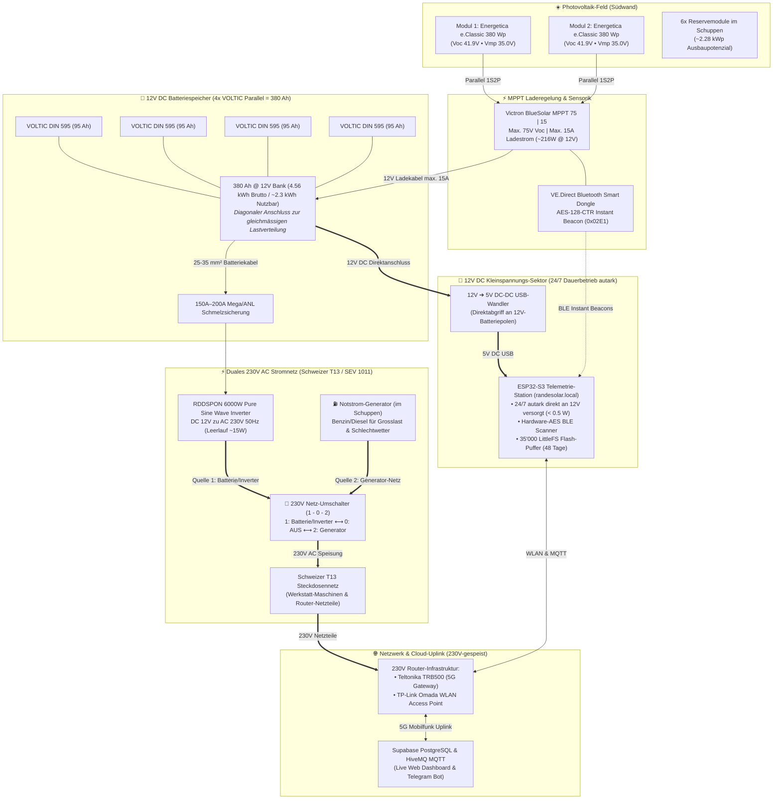
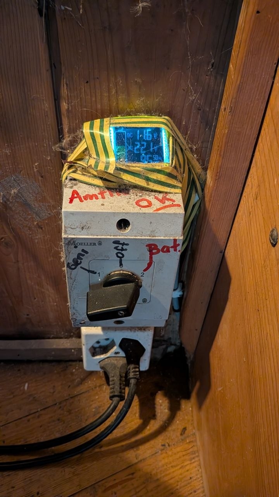

# ☀️ RandeSolar Systemarchitektur & Auslegungsdokumentation

**Standort:** RandeLab • Underes Ätzisloo 189, 8232 Merishausen / Randen  
**Koordinaten:** 47.7701° N, 8.5738° E • **857 m ü. M.** (Amtl. Gebäudeadresse GWR / Swisstopo)  
**Systemtyp:** Autonomes Off-Grid Solar-Inselnetz mit 12V-Batteriespeicher & 230V-Wechselrichter  
**Stand:** November 2026  
**Schwesterdokument:** 👉 [**`NETWORK_5G_INFRASTRUCTURE.md`**](./NETWORK_5G_INFRASTRUCTURE.md) (5G Gateway, ubus API, Band-Locking & Wi-Fi)

---

## 1. Systemübersicht & Blockschaltbild



---

## 2. Fotodokumentation & Feldeinsatz vor Ort

### 2.1 Photovoltaik-Feld & Modulkennzeichnung
Die beiden aktuell aktiven Module sind an der Naturstein- und Holzwand des RandeLabs Richtung Süd aufgestellt. Die e.ISP®-Halbzellentechnologie sorgt dafür, dass selbst bei teilweisem Schattenwurf durch die Balkonbalken oder umstehende Bäume der restliche Modulteil ungestört weiterproduziert:

| Aktuelles 2-Panel Setup (1S2P) | Typenschild & Kalibrierungs-Laserung |
| :---: | :---: |
|  |  |
| *Zwei Energetica e.Classic M HC Module an der RandeLab-Wand* | *Laser-Typenschild: 380er Klasse, Flash-Test 384,9 Wp!* |

### 2.2 Netzwerk- & Gateway-Infrastruktur (am 230V-Hausnetz)
Die Anbindung an das Internet und das lokale WLAN-Netzwerk des RandeLabs erfolgt über zwei Komponenten:

* **Outdoor 5G Gateway (`192.168.2.1`):** **Teltonika TRB500** Industrie-Gateway, wetterfest unter dem Holzvordach montiert, stellt über das Mobilfunknetz den WAN-Uplink her.
* **Indoor WLAN Access Point (`192.168.1.1`):** **TP-Link Omada**, per PoE-Injektor versorgt, spannt das lokale RandeLab-WLAN auf.
* **230V-Speisung:** Beide Netzwerkkomponenten sind über Steckernetzteile an das **230V AC Hausnetz** angeschlossen und laufen somit, wenn der Hauptumschalter auf Inverter (1) oder Generator (2) steht. Bei ausgeschaltetem 230V-Netz bleibt der ESP32-S3 autark über seine direkte 12V-Leitung aktiv und puffert alle Solardaten im internen Flash (siehe Abschnitt 2.4).
* **Geplante Optimierung (12V DC Direktversorgung):** Da das Teltonika TRB500 nativ 9–30V DC unterstützt, ist eine direkte 12V-Batterieversorgung geplant. Dadurch kann der 6000W-Wechselrichter bei Abwesenheit/Nacht komplett abgeschaltet werden (spart 25–40W Idle = ~700 Wh/Tag!), während WLAN, 5G-Internet und Telemetrie 24/7 online bleiben (siehe [**`NETWORK_5G_INFRASTRUCTURE.md` Abschnitt 8**](./NETWORK_5G_INFRASTRUCTURE.md#8-mögliche--geplante-optimierung-12v-dc-direktversorgung-für-5g-gateway--wlan-router)).

| Outdoor 4G/5G Teltonika Gateway | Indoor TP-Link Omada WLAN-Router |
| :---: | :---: |
|  |  |
| *Wetterfeste Teltonika TRB500 Station (`192.168.2.1`) unter dem Holzvordach* | *TP-Link Access Point (`192.168.1.1`) an der Wand (12V DC Speisung links, gelbes LAN-Kabel rechts; das ovale schwarze Gehäuse rechts ist ein Lampenschalter)* |

> [!NOTE]
> **Ausführliche Mobilfunk- & HF-Dokumentation im Schwesterdokument:**  
> Sämtliche HF-Messwerte, 5G-NSA Trägerbündelung (LTE B3 / 5G N1), Signalanalysen (RSRP/SINR vs. Randen-Waldfeuchte), Ookla WAN-Speedtests (80 Mbit/s Up / 22 Mbit/s Down), die ubus JSON-RPC Router-API, externe Antennenoptionen, SIM-Vergleiche (Schweiz vs. Deutschland) sowie die geographische Funkfeldkarte sind im separaten Fachbericht dokumentiert:  
> 👉 [**`NETWORK_5G_INFRASTRUCTURE.md`**](./NETWORK_5G_INFRASTRUCTURE.md) & [**`docs/maps/README.md`**](./docs/maps/README.md)

### 2.3 Batteriespeicher (4x VOLTIC) & RDDSPON 6000W Inverter
Die 4 VOLTIC Batterien (DIN 595, je 95 Ah) sind parallel geschaltet und bilden eine massive 380 Ah Pufferbank (4.56 kWh Bruttospeicher). Darauf montiert sitzt der RDDSPON 6000W Reinsinus-Wechselrichter:

| 4-fach Batteriebank & 6000W Inverter | 230V Netz-Umschalter (Inverter ⟷ 0 ⟷ Generator) |
| :---: | :---: |
|  |  |
| *4x VOLTIC DIN 595 parallel (380 Ah @ 12V) mit RDDSPON 6000W Pure Sine Wave Inverter* | *Robuster 230V Nockenschalter (1 - 0 - 2) zur Umschaltung des Schweizer T13-Hausnetzes* |

### 2.4 Zweistufige Stromversorgungs-Architektur, Generator & 24/7 Autarkie
Ein zentraler mechatronischer Designvorteil von RandeSolar ist die bewusste Trennung der Spannungsversorgungen sowie die duale 230V-Einspeisung:

1. **Duales 230V AC Stromnetz (Schweizer T13 / SEV 1011):**
   * Das RandeLab verfügt über eine vollwertige 230V-Gebäudeinstallation mit Schweizer Typ 13 Steckdosen.
   * Über den robusten **manuellen Netz-Umschalter (1 - 0 - 2)** an der Wand kann das gesamte 230V-Netz umgeschaltet werden:
     * **Stellung 1 (Solar & Batterie):** Speisung über den RDDSPON 6000W Reinsinus-Wechselrichter aus der 12V-Batteriebank.
     * **Stellung 0 (AUS):** Allpolige Netztrennung für Wartung oder totale Ruhestromabschaltung.
     * **Stellung 2 (Notstrom-Generator):** Speisung über den im **Schuppen stationierten Benzin-/Diesel-Generator**. Ideal für stromhungrige Werkstatt-Maschinen, schwere Elektrowerkzeuge oder bei tagelangen winterlichen Hochnebelfeldern zur Notladung.
   * **Netzwerk-Versorgung:** Die beiden Router – das **Teltonika TRB500 5G-Gateway** und der **TP-Link Omada WLAN Access Point** (inkl. PoE-Injektor) – werden über dieses 230V-Hausnetz versorgt. Sie laufen somit sowohl im Inverter-Betrieb (Stellung 1) als auch im Generator-Betrieb (Stellung 2).
2. **12V DC Dauerversorgungs-Sektor (Autarker ESP32-S3):**
   * Der **ESP32-S3 Telemetrie-Controller** ist **nicht** an 230V angeschlossen, sondern wird über einen kompakten **12V-zu-5V DC-DC USB-Wandler direkt an den 12V-Batteriepolen** betrieben.
   * *Verbrauch:* Mit < 0.5 Watt (100 mA @ 5V) ist der ESP32 für die 380 Ah Batteriebank vernachlässigbar klein.
   * *Blackout- und Winter-Resilienz:* Selbst wenn das 230V-Netz (Stellung 0) wochenlang ausgeschaltet bleibt (um den ~15–25W Inverter-Leerlauf zu vermeiden), arbeitet der ESP32-S3 unterbrechungsfrei weiter:
     * Er empfängt 24/7 alle BLE-Instant-Beacons des Victron MPPT-Ladereglers.
     * Er puffert alle Lade-, Spannungs- und Solarertragsdaten lückenlos in seinem **35'000-Datensatz-Flash-Speicher (LittleFS)**.
     * Sobald der 230V-Schalter wieder auf Inverter oder Generator gestellt wird und die beiden Router hochfahren, verbindet sich der ESP32 automatisch wieder mit dem RandeLab-WLAN und leert ("drained") alle aufgelaufenen Datensätze automatisch und chronologisch in die Supabase Cloud-Datenbank!

---

## 3. Technische Daten der Module: Energetica e.Classic M HC

Laut offiziellem Datenblatt (**Energetica Photovoltaic Industries GmbH**, Liebenfels, Österreich):

| Parameter | Wert (STC: 1000 W/m², 25°C) | Wert (NMOT: 800 W/m², 20°C, 1 m/s) |
| :--- | :--- | :--- |
| **Nennleistung ($P_{max}$)** | **365 Wp – 390 Wp** (typ. ~380 Wp) | 274 Wp – 292 Wp |
| **Leerlaufspannung ($V_{oc}$)** | **41.17 V – 41.93 V** | 38.88 V – 39.60 V |
| **Arbeitspunktspannung ($V_{mpp}$)** | **34.37 V – 35.03 V** | 32.44 V – 33.06 V |
| **Arbeitspunktstrom ($I_{mpp}$)** | **10.67 A – 11.16 A** | 8.45 A – 8.84 A |
| **Kurzschlussstrom ($I_{sc}$)** | **11.26 A – 11.95 A** | 8.90 A – 9.45 A |
| **Zellentechnologie** | 120 monokristalline PERC Halbzellen | 12-Busbar Technologie |
| **Verschattungsschutz** | e.ISP® integrierte Elektronik auf Strang-Ebene | Verhindert Hotspots |
| **Abmessungen & Gewicht** | 1780 × 1042 × 36 mm • **21 kg** | Aluminiumrahmen schwarz |
| **Temperaturkoeffizient ($V_{oc}$)**| **$-0.26\% / \text{K}$** | Spannung steigt bei Kälte! |

---

## 4. Kritische Auslegungsgrenzen für den Victron MPPT 75 | 15

### 4.1 Die 75V-Spannungsgrenze (Zerstörungsgefahr!)
* **Max. zulässige PV-Leerlaufspannung am Regler:** **75 V**
* **1 Modul:** $V_{oc} = 41.93\text{ V}$ $\rightarrow$ **Sicherer Betrieb** ($41.93\text{ V} \ll 75\text{ V}$)
* **2 Module in Reihe:** 
  $$V_{oc} (25^\circ\text{C}) = 41.93\text{ V} \times 2 = \mathbf{83.86\text{ V}} > 75\text{ V} \quad \text{⛔ VERBOTEN!}$$
  Bei $-15^\circ\text{C}$ im Randen-Winter:
  $$V_{oc} (-15^\circ\text{C}) = 83.86\text{ V} \times [1 + (-0.0026) \times (-40)] \approx \mathbf{92.6\text{ V}}!$$
  > **Ergebnis:** Zwei dieser Module in Serie zerstören die Eingangsstufe des Victron 75|15 unweigerlich. Die Module dürfen an diesem Regler **ausschliesslich parallel (1S)** betrieben werden!

### 4.2 Die 15A-Ladestromgrenze bei 12V
* **Max. Ladestrom in den Akku:** $15\text{ A}$
* **Max. Ladeleistung:** $15\text{ A} \times 14.4\text{ V} \approx \mathbf{216\text{ W}}$
* **Aktuelles Setup (2 Module parallel = ~760 Wp):**
  * **Volle Sonne:** Der MPPT regelt sauber auf 15 A ab (*Clipping*). Dem Regler schadet das nicht, er nimmt sich nur den Strom, den er verarbeiten kann.
  * **Bewölkt / Randen-Hochnebel:** Bei nur 25% Einstrahlung liefern zwei 380W-Module immer noch $\approx \mathbf{190\text{ W}}$ und laden die Batterie mit fast maximalem Ladestrom!

---

## 5. Batterie-Physik, Schongrenzen & Peukert-Effekt (12V AGM)

Die Bleivlies-Batterie (AGM) bildet das chemische Herz des RandeLab-Inselnetzes. Für eine lange Lebensdauer (5–10 Jahre statt 1–2 Jahre) gelten spezifische mechatronische Grundregeln:

### 5.1 Ladekennlinie & Spannungsfenster (3-Stufen-Ladung durch Victron MPPT)
* **Bulk-Phase (Hauptladung):** Maximaler Strom (bis 15 A) fliesst in den Akku, bis die Ladeschlussspannung von **$14.40\text{ V}$** erreicht ist. Der Akku erreicht hier ca. 80% SoC.
* **Absorption-Phase (Nachladung):** Spannung wird konstant auf **$14.40\text{ V}$** gehalten, der Ladestrom sinkt allmählich ab (Sättigung der Platten).
* **Float-Phase (Erhaltungsladung):** Spannung wird auf schonende **$13.80\text{ V}$** abgesenkt, um Gitterkorrosion und Wasserverlust zu verhindern.

### 5.2 Entladeschwellen & Depth of Discharge (DoD)
Bleibatterien altern exponentiell mit der Entladetiefe:
* **Entladung bis 30% DoD (Restspannung ~12.4V):** über **1.200 Zyklen** Lebensdauer.
* **Entladung bis 50% DoD (Restspannung ~12.2V):** ca. **600 – 800 Zyklen** *(Empfohlene Schongrenze)*.
* **Entladung bis 80% DoD (Restspannung ~11.8V):** nur noch **250 – 350 Zyklen**.
* **Tiefentladung unter 11.5V:** Führt zu rapider Sulfatierung der Bleiplatten und dauerhaftem Kapazitätsverlust!

### 5.3 Die 380 Ah Batteriebank (4x VOLTIC DIN 595 parallel) & Peukert-Effekt
Auf dem Foto ist zu sehen: Es sind **4 Stück VOLTIC DIN 595 (je 95 Ah)** parallel geschaltet:
* **Gesamtkapazität:** $4 \times 95\text{ Ah} = \mathbf{380\text{ Ah bei 12 V}}$
* **Brutto-Energieinhalt:** $380\text{ Ah} \times 12\text{ V} = \mathbf{4.56\text{ kWh}}$
* **Nutzbare Energie (50% DoD Schongrenze):** $\mathbf{\approx 2.28\text{ kWh (190 Ah)}}$

#### Der enorme Vorteil der 4-fach Parallelschaltung:
Wird eine Grosslast am RDDSPON 6000W Inverter betrieben (z.B. $1200\text{ W} = 100\text{ A}$ Gesamtstrom), teilt sich dieser Strom gleichmässig auf alle 4 Batterien auf:
$$\text{Strom pro Batterie} = \frac{100\text{ A}}{4} = \mathbf{25\text{ A pro Akku}}$$
Dadurch wird der gefürchtete **Peukert-Effekt massiv abgemildert**! Die Akkus erwärmen sich kaum, der Spannungseinbruch (*Voltage Sag*) bleibt minimal, und die chemische Kapazität bleibt zu über 80% erhalten.

#### Reale Laufzeiten der 380 Ah Bank (bis 50% Schongrenze):

| Last am 230V Inverter | Stromaufnahme (12V Gesamt) | Strom pro Batterie | Reale Laufzeit bis 50% DoD |
| :--- | :--- | :--- | :--- |
| **Router & ESP32 (10 W)** | **~0.8 A** | ~0.2 A | **~230 Stunden (fast 10 Tage Autarkie!)** |
| **Laptop & LED (60 W)** | **~5.5 A** | ~1.4 A | **~34 Stunden** |
| **Lötkolben / Elektronik (150 W)** | **~14 A** | ~3.5 A | **~13 Stunden** |
| **Handkreissäge / Sauger (1000 W)** | **~95 A** | ~24 A | **~95 Minuten** |
| **Kaffeemaschine / Föhn (1500 W)** | **~145 A** | ~36 A | **~55 Minuten** |

### 5.4 Mechatronische Optimierungstipps für die 4-fach Verschaltung

1. **Diagonaler Anschluss (Perfekte Balancierung):**
   * Damit alle 4 Batterien exakt gleichmässig ge- und entladen werden, sollte der Wechselrichter **diagonal** angeschlossen sein:
     * **Inverter Plus (+):** An den Pluspol der **1. Batterie (ganz links)**.
     * **Inverter Minus (-):** An den Minuspol der **4. Batterie (ganz rechts)**.
   * Werden Plus und Minus an denselben inneren Akku geklemmt, fliesst der Strom den Weg des geringsten Widerstands $\rightarrow$ die inneren Akkus altern schneller als die äusseren.
2. **Hochstromsicherung (Mega-Fuse):**
   * 4 parallele 95Ah-Starterbatterien liefern im Kurzschlussfall über **3'000 Ampere** (Lichtbogenschweiss-Strom!).
   * Eine **150 A oder 200 A Mega-Fuse** (mit Sicherungshalter) direkt am Haupt-Pluspol schützt die dicken Leitungen vor Überhitzung.

---

## 6. Der RDDSPON 230V Inverter im Inselbetrieb

### 6.1 Die Leerlaufstrom-Falle & Automatischer Re-Boot (StamPLC Relais 1)
Ein Wechselrichter dieser Leistungsklasse benötigt zur Bereitstellung der 230V-Sinuswelle im Leerlauf **empirisch gemessen ca. $1.8\text{ A} - 2.2\text{ A}$ (~25 Watt)**.
* **Das Problem im Dauerbetrieb:** Werden Router und 5G-Modem über 230V-Netzteile betrieben, summiert sich die Dauerlast auf **$\sim 45\text{ Watt}$ ($3.6\text{ A}$ @ 12V = $\approx 1.080\text{ Wh/Tag}$)**!
* **Die Latch-Fault-Falle:** Fällt die Batteriespannung unter ca. $10.7\text{ V}$, schaltet der Inverter ab und verharrt im Dauer-Piepsen (Fehler-Latch). Er läuft bei Sonnenaufgang **nicht** automatisch wieder an.
* **Die Lösung (Automatisierter Power-Cycle via StamPLC / ESP32):**
  * Das Frontschalter-Kabel des Inverters wird über **StamPLC Relais 1** geschleift.
  * **Unterspannungsschutz ($V_{batt} < 11.5\text{ V}$):** Relais 1 öffnet $\rightarrow$ Inverter wird sauber abgeschaltet, *bevor* er in die Pieps-Blockade rennt.
  * **Automatischer Kaltstart ($V_{batt} \ge 12.8\text{ V}$):** Sobald die Sonne den Akku lädt, schliesst Relais 1 $\rightarrow$ Inverter bootet automatisch, 230V startet, Internet verbindet sich selbstständig.
* **Langfristiges Ziel:** Router & 5G-PoE direkt an den 12V **LOAD-Ausgang** des Victron MPPT anschliessen (schaltet bei $11.8\text{ V}$ ab und bei $12.5\text{ V}$ vollautomatisch wieder ein).

### 6.2 Netzform & Personenschutz im Inselnetz (IT-Netz)
Ein einfacher Inverter erzeugt ein **ungeerdetes Inselnetz (IT-System)**. Beide Pole der Schuko-Steckdose führen Potenzial gegeneinander, aber keiner ist mit Erde verbunden.
* Das Berühren eines einzelnen Leiters führt nicht sofort zum Stromschlag (da kein Rückpfad über die Erde existiert).
* Wird jedoch ein zweites fehlerhaftes Gerät eingesteckt, kann Lebensgefahr entstehen.
* Für den Werkstatteinsatz empfiehlt sich ein mobiler Personenschutzschalter (PRCD-Zwischenstecker) oder das Erden des Wechselrichter-Massebolzens an einen Erdspieß vor dem Labor.

### 6.3 Sicherheits-Checkliste für den 230V-Betrieb
1. **Batteriekabel:** Da der Inverter bei 1500 W Dauerlast an 12 V ca. **$135\text{ A}$** zieht (und bei 4000 W Spitzenlast über $350\text{ A}$!), müssen die Batteriekabel **mindestens $25\text{ mm}^2$ oder $35\text{ mm}^2$** dick und maximal **1 Meter kurz** sein.
2. **Schmelzsicherung:** Eine **150 A Mega-Fuse** oder ANL-Sicherung direkt am Pluspol der Batterie schützt vor Kabelbrand im Kurzschlussfall.
3. **Abschalten bei Nichtgebrauch:** Wegen des Leerlaufstroms (~15 W) den Inverter nach Beendigung der 230V-Arbeiten ausschalten.

---

## 7. Ausblick: Das 3-Kilowatt-Potenzial (Alle 8 Module)

Mit allen 8 Modulen im Schuppen verfügt das RandeLab über **$8 \times 380\text{ Wp} \approx \mathbf{3.040\text{ Wp}}$**. 

Um diese gewaltige Leistung vollständig für den **RDDSPON-Wechselrichter (4000W–5000W)** nutzbar zu machen, bieten sich folgende Ausbauvarianten an:

| Ausbaustufe | Hardware-Konfiguration | Geeignete Modul-Verschaltung | Nutzen für RandeLab |
| :--- | :--- | :--- | :--- |
| **Status Quo (Optimal für 75\|15)** | 2 Module parallel an Victron MPPT 75\|15 | **1S2P** (1 Strang, 2 parallel) | Perfekte Schlechtwetter-Ladung für 12V-Batterie, kein Neukauf nötig |
| **Ausbaustufe 1 (2. Laderegler)** | Weiterer Victron MPPT (z.B. SmartSolar 100\|20) parallel am Akku | 2 Module an 75\|15 + 2 Module an 100\|20 | Verdoppelt die Ladeleistung auf 35 A (~500 W) in den 12V-Akku |
| **Ausbaustufe 2 (Vollausbau 3 kWp)** | 1x Victron SmartSolar MPPT 150\|60 oder 150\|85 (ideal bei 24V oder 48V) | **2S4P** oder **3S2P** | Volle 3 kW Leistung: betreibt Werkzeuge, Heizung, Kaffeevollautomaten autark |

---

## 8. Autonome Telemetrie & Microclimate Observatory (ESP32-S3)

Das Kraftwerk wird rund um die Uhr durch einen autarken ESP32-S3 Mikrocontroller überwacht, der direkt im RandeLab montiert ist:

* **Hardware-Entschlüsselung (BLE Instant Readout):**
  * Liest kontaktlos alle 2–4 Sekunden verschlüsselte Bluetooth-Beacons des Victron-Dongles (Manufacturer ID `0x02E1`).
  * Entschlüsselt die 89-Bit-Nutzdaten mit AES-128-CTR direkt in Silizium (Solarleistung, Batteriespannung, Ladestrom, Ertrag, Status).
* **35'000-Datensatz-Offline-Puffer (LittleFS Flash):**
  * Hält bis zu **48.6 Tage lückenlose 2-Minuten-Messungen** bei vollständigem Internetausfall im Onboard-Flash.
  * Ringpuffer-Schutz und High-Speed-Drain (bis zu 250 Datensätze pro 2-Min-Zyklus) bei Netzwerkwiederkehr.
  * Direkter CSV-Download über `http://randesolar.local/api/buffer/csv`.
* **MeteoSwiss Mikroklima-Korrelation:**
  * Ruft hochauflösende Modelldaten (ICON-CH, 1 km Gitter) für Merishausen / Randen ab (Solarstrahlung in $W/m^2$, Bewölkung in %, Regen in mm, Temperatur in °C).
  * Korreliert Sonneneinstrahlung mit realer Ernte und 5G-Mobilfunkperformance.
* **Live-Dashboards & Benachrichtigungen:**
  * Lokale Station: `http://randesolar.local`
  * Globales Web-Dashboard: [randelab.github.io/RandeSolar](https://randelab.github.io/RandeSolar/)
  * Telegram-Bot: `@RandeSolarBot` (`/status`, `/weather`, `/speed`, `/mood`)

---

## 9. Telemetrie-Integration & Datenfluss

Die Telemetrie-Architektur verbindet die mechatronische Solaranlage mit der Überwachung und Cloud-Synchronisation:

```
[Victron MPPT 75|15]
        │
        ▼ (BLE Instant Beacons alle 2-4s • AES-128 Hardware-Decrypt)
[ESP32-S3 Station (12V DC Direktversorgung, < 0.5 W)]
        │
        ├─► [LittleFS Flash-Puffer: 35'000 Datensätze / 48 Tage Offline-Autarkie]
        │
        ▼ (WLAN 2.4 GHz • wenn 230V Hausnetz aktiv)
[TP-Link WLAN AP & Teltonika TRB500 5G Gateway (am 230V Netz)]
        │
        ├─► ubus JSON-RPC Router-Telemetrie (Signal, Band, Speed)
        ▼ (5G Mobilfunk WAN-Uplink)
[Supabase Cloud PostgreSQL & HiveMQ MQTT Broker]
        │
        ├─► Web Dashboard (randelab.github.io/RandeSolar)
        └─► Telegram Bot (@RandeSolarBot)
```

### 9.1 Intelligente Offline- / Online-Betriebsmodi
* **Online-Modus (230V-Netz aktiv):** Der ESP32 sendet alle 20 Sekunden Live-Messwerte (Solarleistung, Batteriespannung, Ladestrom, Historie) an die Supabase-Datenbank und via MQTT ins globale Web-Dashboard. Parallel fragt er über das interne LAN die Mobilfunkdaten des Teltonika-Routers ab.
* **Offline-Modus (230V-Netz aus):** Bleibt das 230V-Netz ausgeschaltet (um den ~15W Inverter-Ruhestrom bei Abwesenheit zu sparen), speichert der 12V-autarke ESP32 alle Solar- und Batteriedaten lückenlos im Onboard-Flash ab. Sobald das 230V-Netz wieder eingeschaltet wird und die Router booten, leert der Controller den Puffer automatisch mit hoher Geschwindigkeit (bis zu 250 Datensätze pro Zyklus) in die Cloud.

---

## 10. Weiterführende Dokumentation & Fachberichte

* 👉 [**`NETWORK_5G_INFRASTRUCTURE.md`**](./NETWORK_5G_INFRASTRUCTURE.md): Vollständiges Mobilfunk- & Netzwerk-Engineering, Quectel X55 5G-Modem, ubus JSON-RPC Protokolle, WAN-Speedtest-Analyse, Richtantennen-Vergleiche und SIM-Provider-Strategien (Schweiz vs. Deutschland).
* 👉 [**`docs/maps/README.md`**](./docs/maps/README.md): Randen 5G & HF-Radar Topographie, interaktive OpenStreetMap-Vektorkarte und Masten-Standortanalyse.
* 👉 [**`OFFLINE_RESILIENCE.md`**](./OFFLINE_RESILIENCE.md): Technische Spezifikation des LittleFS Flash-Ringpuffers und Ausfallsicherheits-Mechanismen.


