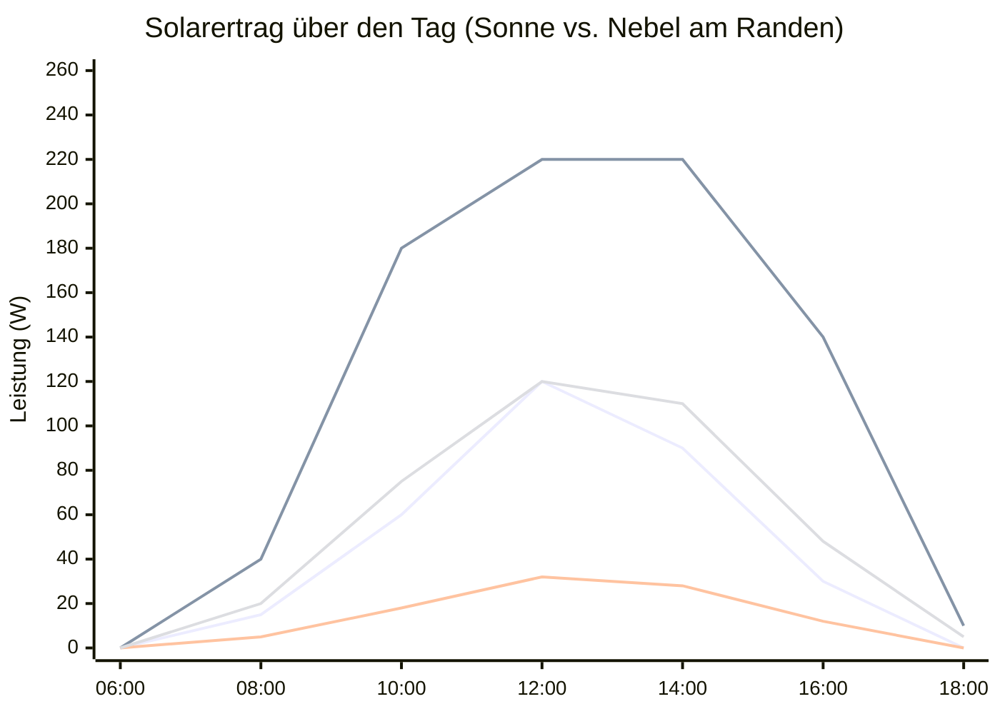

# ☀️ RandeSolar Systemarchitektur & Auslegungsdokumentation

**Standort:** RandeLab • Underes Ätzisloo 189, 8232 Merishausen / Randen  
**Koordinaten:** 47.7612° N, 8.5868° E • ~640 m ü. M.  
**Systemtyp:** Autonomes Off-Grid Solar-Inselnetz mit 12V-Batteriespeicher & 230V-Wechselrichter  
**Datum:** November 2026

---

## 1. Systemübersicht & Blockschaltbild

```mermaid
flowchart TD
    subgraph PV["☀️ Photovoltaik-Feld (RandeLab Dach / Freifläche)"]
        P1["Panel 1 (aktiv)"]
        P2["Panel 2 (aktiv)"]
        P3["Panel 3 (Schuppen)"]
        P4["Panel 4 (Schuppen)"]
        P5["Panel 5 (Schuppen)"]
        P6["Panel 6 (Schuppen)"]
        P7["Panel 7 (Schuppen)"]
        P8["Panel 8 (Schuppen)"]
    end

    subgraph MPPT_UNIT["⚡ Victron BlueSolar MPPT 75 | 15"]
        MPPT["MPPT Laderegler<br/>(Max 75V Voc / 15A Ladeleistung)"]
        DONGLE["VE.Direct Bluetooth Smart Dongle<br/>(AES-128-CTR Beacon 0x02E1)"]
        MPPT --- DONGLE
    end

    subgraph DC_BUS["🔋 12V DC Hauptschiene"]
        BATT["12V AGM / Blei-Vlies Akku<br/>(Puffer für Tag & Nacht)"]
        FUSE_INV["100A–150A Hochstromsicherung<br/>(Mega / ANL Fuse)"]
    end

    subgraph INVERTER_UNIT["⚡ 230V AC Stromnetz"]
        INV["RDDSPON Pure Sine Wave Inverter<br/>(DC 12V ➔ AC 230V 50Hz Echte Sinuswelle)"]
        AC_SOCKETS["2x EU-Schuko Steckdosen<br/>(Laptops, Werkzeuge, Ladegeräte)"]
        INV --> AC_SOCKETS
    end

    subgraph MONITORING["📡 Telemetrie & Microclimate Observatory"]
        ESP32["ESP32-S3 Station (randesolar.local)<br/>• Hardware-AES BLE Scanner<br/>• 35'000 Flash-Puffer (48 Tage)<br/>• 5G Speedtest & Latenz-Benchmarking"]
        ROUTER["5G Cellular Router (RandeLab WLAN)"]
        CLOUD["Supabase PostgreSQL & HiveMQ MQTT"]
    end

    P1 & P2 & P3 & P4 & P5 & P6 & P7 & P8 ==>|DC Solarleitung| MPPT
    MPPT ==>|12V Ladekabel (max 15A)| BATT
    BATT ==>|Dickes Batteriekabel| FUSE_INV ==> INV
    DONGLE -.->|Drahtlose BLE Instant Beacons| ESP32
    ESP32 <-->|WLAN & MQTT| ROUTER <-->|5G Uplink| CLOUD
```

---

## 2. Komponenten-Spezifikationen

### 2.1 Laderegler: Victron BlueSolar MPPT 75 | 15
* **Hersteller:** Victron Energy (Niederlande)
* **Topologie:** Ultra-schneller MPPT-Abwärtswandler (Buck-Converter)
* **Maximale PV-Leerlaufspannung ($V_{oc}$):** **75 V**
  > Die 75V-Grenze ist eine absolute Zerstörungsgrenze. Bei Kälte im Randen-Winter (-10 °C) steigt die Leerlaufspannung von Solarzellen um ca. **10% bis 15%** an (Temperaturkoeffizient typisch $-0.3\% / ^\circ\text{C}$). Die nominale $V_{oc}$ bei 25°C muss deshalb unter **65 V** bleiben!
* **Maximaler Batterie-Ladestrom:** **15 A**
* **Nenn-Ladeleistung bei 12V-Batterie:** $15\text{ A} \times 14.4\text{ V} \approx \mathbf{216\text{ W}}$
* **Schnittstelle:** 4-Pin VE.Direct Port (belegt durch Victron Bluetooth Smart Dongle)
* **Lastausgang (`LOAD`):** Maximal 15 A Dauerstrom (ausschliesslich für kleine 12V-Verbraucher wie Beleuchtung oder Router, **niemals für den Wechselrichter!**)

### 2.2 Wechselrichter: RDDSPON Pure Sine Wave Inverter
* **Eingangsspannung:** 12 V DC (Schraubbolzen für M8/M10 Kabelschuhe)
* **Ausgangsspannung:** 220 V – 240 V AC, 50 Hz Reiner Sinus (*Pure Sine Wave*)
* **Leistungsklasse:** 4000 W – 5000 W Surge / ~1500 W – 2000 W Dauerlast
* **Display:** Digitales Frontpanel mit Spannungs- und Lastanzeige
* **Wirkungsgrad:** ca. 90%
* **Ruhestrom (Leerlaufverbrauch):** ca. 1.0 A bis 1.5 A bei 12 V (~12 W bis 18 W)
* **Sicherheitsanschluss:** MUSS direkt mit dicken Leitungen (mindestens 25 mm² bis 35 mm²) und einer Hochstromsicherung an die Batteriepole geklemmt werden.

### 2.3 Solarmodule (2 aktiv + 6 im Schuppen = 8 Total)
* **Aktuelle Konfiguration:** 2 Panels parallel vor dem Gebäude (liefern aktuell ca. 20 W – 60 W bei trübem Wetter)
* **Potenzial:** Ausbau auf alle 8 Panels für maximale Winter- und Schlechtwetter-Ausbeute.

---

## 3. Auslegungsanalyse: Erweiterung auf 8 Panels

Da der Victron MPPT 75 | 15 bei 12V Batteriespannung auf **15 A (~220 W)** begrenzt ist, stellt sich die Frage: *Macht es Sinn, 8 Panels an diesen Regler anzuschliessen?*

### Das Prinzip des »Overpaneling« (Überbelegung)
In der Solar-Praxis – besonders auf 640 m Höhe am Randen mit häufigem Nebel, Hochnebel und Bewölkung – ist **gezieltes Overpaneling eine der effektivsten Massnahmen überhaupt**:



* **2 Panels bei Sonne:** Erreicht nur selten die 120 W-Marke.
* **8 Panels bei Sonne:** Trifft ab 10:30 Uhr auf das 220W-Limit des Victron (wird sauber auf 15A gedeckelt, schadet dem Regler nicht!). Die Batterie ist bereits vor dem Mittagessen randvoll geladen.
* **2 Panels bei Randen-Hochnebel:** Dümpelt bei 15 W – 30 W herum. Reicht kaum, um den Ruhestrom der Geräte und die Batterie-Selbstentladung zu decken.
* **8 Panels bei Randen-Hochnebel:** Bringt solide **75 W – 120 W** Ertrag trotz dicker Suppe! Das Kraftwerk bleibt autark.

---

## 4. Schaltungstopologien für 8 Panels

Unter Berücksichtigung der **75 V Maximalspannung** des Reglers gibt es zwei sinnvolle Verschaltungsmöglichkeiten:

### Topologie A: 2S4P (Empfohlen ⭐)
**4 parallele Stränge mit jeweils 2 Panels in Serie**

```text
  Strang 1:  [Panel 1] ──(+) (─)── [Panel 2] ──(+) ────┐
  Strang 2:  [Panel 3] ──(+) (─)── [Panel 4] ──(+) ────┼───> Zum MPPT Solar (+)
  Strang 3:  [Panel 5] ──(+) (─)── [Panel 6] ──(+) ────┼
  Strang 4:  [Panel 7] ──(+) (─)── [Panel 8] ──(+) ────┘

  Minus aller Stränge ─────────────────────────────────> Zum MPPT Solar (-)
```

* **Elektrische Werte (bei typischen 36-Zellen 12V-Panels):**
  * Nenn-Arbeitsspannung ($V_{mp}$): $2 \times 18\text{ V} = \mathbf{36\text{ V}}$
  * Leerlaufspannung ($V_{oc}$ bei 25°C): $2 \times 21.6\text{ V} = \mathbf{43.2\text{ V}}$
  * Leerlaufspannung ($V_{oc}$ bei Kälte -15°C): $\approx \mathbf{49\text{ V}}$ $\rightarrow$ **Sicherer Abstand zu den 75 V!**
* **Vorteile:**
  1. **Früher Ladebeginn:** Der MPPT braucht zum Starten $V_{pv} \ge V_{batt} + 5\text{ V}$ (also $\approx 17.5\text{ V}$). Bei 36 V Modulspannung beginnt die Ladung schon bei der allerersten Morgendämmerung.
  2. **Halbierte Kabelströme:** Dünnere Leitungen möglich, geringerer Spannungsabfall über die Zuleitung vom Dach/Garten zum Regler.
  3. **Ausfallsicherheit:** Fällt ein Strang durch Teilverschattung (z.B. Baumzweige) ab, liefern die anderen 3 Stränge ungehindert weiter.

---

### Topologie B: Alle 8 parallel (1S8P)
* **Elektrische Werte:**
  * Arbeitsspannung ($V_{mp}$): $\approx \mathbf{18\text{ V}}$
  * Stromstärke: $8 \times I_{mp} \approx \mathbf{25\text{ A} - 35\text{ A}}$
* **Nachteile:**
  * Sehr hohe Ströme auf den Solarkabeln $\rightarrow$ dicke $6\text{ mm}^2$ oder $10\text{ mm}^2$ Leitungen und teure 8-fach MC4-Y-Verteiler nötig.
  * An heissen Sommertagen sinkt die Panelspannung durch Hitze auf ~15 V ab. Das ist zu nah an der Batteriespannung (14.4 V) $\rightarrow$ der MPPT verliert an Wirkungsgrad.

---

## 5. Verkabelungs- und Sicherheitsrichtlinien

1. **Batterieanschluss des Wechselrichters:**
   * **Querschnitt:** Mindestens **$25\text{ mm}^2$** bis **$35\text{ mm}^2$** Kupferkabel mit verpressten Rohrkabelschuhen.
   * **Leitungslänge:** So kurz wie irgend möglich halten (unter 1 Meter).
   * **Sicherung:** Direkt am Pluspol der Batterie eine **100A oder 150A ANL/Mega-Sicherung** montieren.
2. **Victron MPPT Absicherung:**
   * Ladeleitung zur Batterie mit einer **20 A Flachstecksicherung** (oder Kfz-Automat) absichern.
3. **Gemeinsame Masse (GND):**
   * Alle Komponenten (Batterie-Minus, MPPT-Minus, ESP32-GND) teilen sich dasselbe Bezugspotential.
   * Für den optionalen Spannungsteiler zur Panelmessung wird der Minuspol der Solarklemme ebenfalls mit GND verbunden.

---

## 6. Telemetrie & Energiebilanz im RandeSolar-Dashboard

Mit der aktuellen Firmware (`v3.4`) und dem **35'000-Einträge Flash-Speicher** ist das System für autonome Langzeitbeobachtung ausgelegt:
* **Tagesausbeute (kWh):** Zeigt exakt, wie viel Energie das Feld täglich geerntet hat.
* **Batteriespannungs-Trend (V):** Erfasst Tag- und Nachtverlauf im echten Zeitmassstab. Bei Nachtverbrauch durch den Wechselrichter sieht man sofort die Entladekurve.
* **Klimakorrelation:** Einstrahlung ($W/m^2$), Wolkenbedeckung (%) und Temperatur (°C) von MeteoSwiss zeigen unmittelbar das Verhältnis von Wetterlage zu Ladeleistung.
