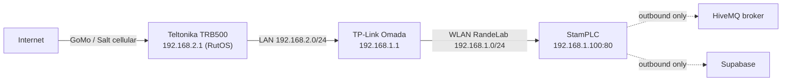
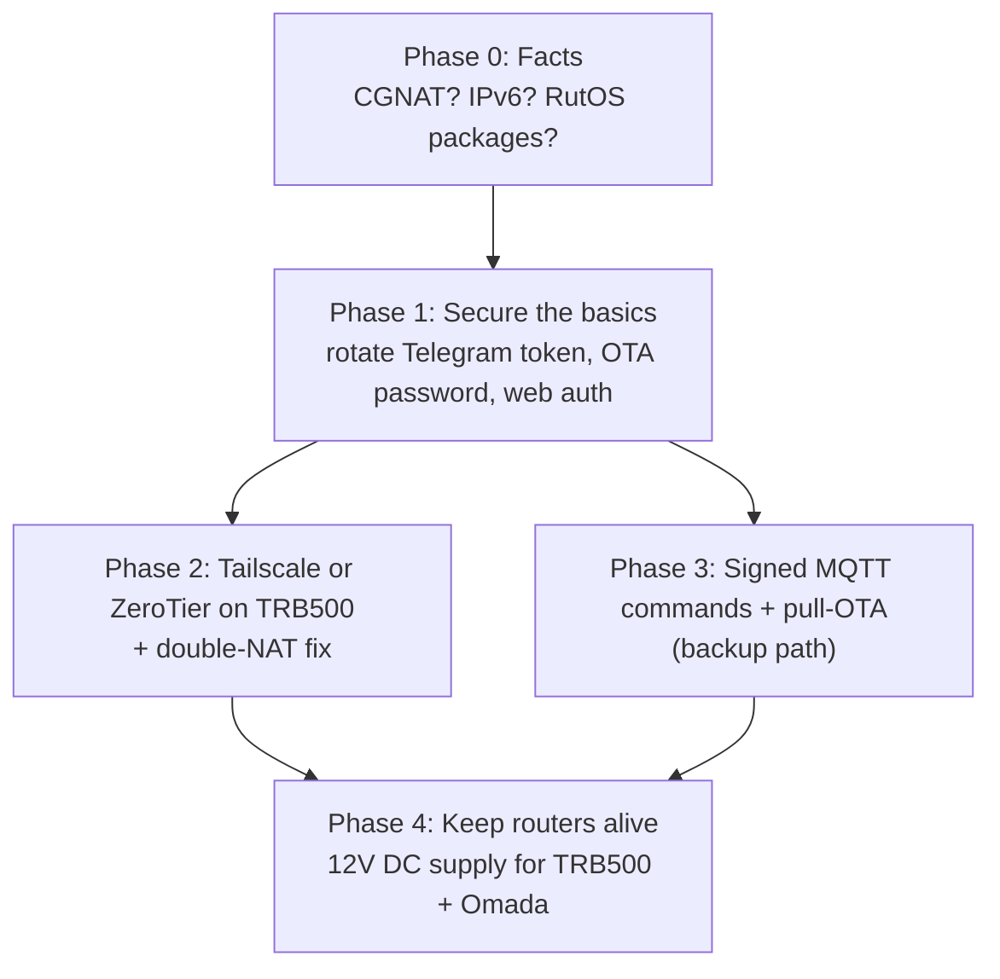

# 🌍 Remote Access Plan: Reaching the StamPLC from the Internet

**Status:** Plan only. Nothing configured yet.  
**Goal:** Open the StamPLC web UI (`192.168.1.100`), OTA and relay controls from anywhere, without making RandeLab easy to attack.

---

## 1. Current Topology

Things that already work from outside today, because the StamPLC connects **outbound**:

* Live data: MQTT to HiveMQ, read by the GitHub Pages dashboard.
* History: Supabase.
* Some commands via MQTT (e.g. speedtest trigger, with acknowledgements on `randelab/solar/ack`).

What does **not** work from outside: opening `http://192.168.1.100`, `/update`, ArduinoOTA (port 3232), `/api/relay`.

---

## 2. The Three Obstacles

### 2.1 Carrier-grade NAT (probably, not yet verified)
Swiss mobile data plans (GoMo/Salt included) usually give the modem a **private WAN address** (`10.x.x.x` or `100.64.x.x`) shared behind the carrier's NAT. If so, **port forwarding cannot work at all**, no matter what we set on the routers. Only outbound tunnels work.

### 2.2 Double NAT inside the cabin
The StamPLC sits behind the Omada (`192.168.1.x`), which sits behind the TRB500 (`192.168.2.x`). Anything running on the TRB500 sees only the Omada, not the StamPLC, unless we add a forward/route on the Omada or switch it to pure access-point mode.

### 2.3 The routers die when the inverter is off
The TRB500 and Omada currently run on 230 V from the inverter/generator. If the inverter is switched off (manually, by Relay 1, or by the 11.50 V undervoltage guard), **the internet link disappears and nobody can switch it back on remotely**. Any remote-access setup inherits this limit.

---

## 3. Security Reality Check

> [!CAUTION]
> The StamPLC web server has **no login**. Anyone who can reach port 80 can switch the 230 V inverter (`/api/relay`) and flash new firmware (`/update`). ArduinoOTA on port 3232 also has no password. **Never expose port 80 or 3232 directly to the internet.** Every option below puts an authenticated layer in front.

Related findings in the repo (public on GitHub):

* `src/main.cpp` contains the **Telegram bot token** in plain text. Anyone can take over `@RandeSolarBot`. Should be rotated via BotFather and moved to `include/secrets.h`.
* `web/app.js` contains the Supabase **anon** key. This is normal for a public dashboard, but only safe if Row Level Security on `solar_telemetry` allows read and insert only, no update/delete. Worth checking.
* The HiveMQ broker is public: anyone who guesses `randelab/solar/...` can publish commands.

---

## 4. Options

| # | Option | Works behind CGNAT? | Extra hardware | Cost | Effort | Security |
| :--- | :--- | :---: | :--- | :--- | :--- | :--- |
| A | **Tailscale or ZeroTier on the TRB500** (subnet router) | ✅ | none | free (personal) | low–medium | ✅ strong (device keys) |
| B | **Teltonika RMS** (vendor cloud, "RMS Connect") | ✅ | none | paid credits | low | ✅ good (Teltonika account + 2FA) |
| C | **WireGuard/OpenVPN client on TRB500 → own VPS** | ✅ | small VPS | ~CHF 4/month | medium | ✅ strong |
| D | **Cloudflare Tunnel** (`cloudflared`) | ✅ | Raspberry Pi or similar in the cabin | free | medium | ✅ with Cloudflare Access login |
| E | **Port forwarding** TRB500 → Omada → StamPLC | ❌ under CGNAT | none | maybe paid public IP | low | ❌ unless VPN in front |
| F | **MQTT command channel + pull-OTA** (no inbound at all) | ✅ | none | free | medium (firmware) | ⚠️ needs signed commands or private broker |

### A. Tailscale / ZeroTier on the TRB500 (recommended main path)
RutOS supports ZeroTier and (on recent releases) Tailscale through its package manager. The TRB500 joins a private network and **advertises a route** to the cabin LAN. Laptop and phone join the same network and reach `192.168.1.100` as if they were in the cabin.

* Outbound connection only, so CGNAT does not matter.
* Fix double NAT by **one** of:
  1. Omada in **access-point (bridge) mode**: everything moves into `192.168.2.0/24`, the StamPLC gets e.g. `192.168.2.100`. Simplest, but every hard-coded `192.168.1.x` (firmware, docs, `app.js` local endpoints) must change.
  2. Keep Omada as router, add a **static route** on the TRB500 for `192.168.1.0/24` via the Omada's WAN address, and advertise both subnets.
  3. Keep everything, add a **port forward on the Omada only** (Omada WAN `:8080` → `192.168.1.100:80`). Reach the StamPLC at `http://<omada-wan-ip>:8080` through the tunnel. Least invasive, but OTA on 3232 would need a second forward.
* To check first: TRB500 free flash/RAM for the package, and whether the RutOS version (R_00.07.24.7) offers Tailscale or only ZeroTier.

### B. Teltonika RMS
Teltonika's own cloud. Gives remote WebUI access to the TRB500 and HTTP(S) proxying to LAN devices, plus monitoring and firmware updates for the router itself. Easiest to click together, but it costs credits and depends on Teltonika's service. Same double-NAT issue as A.

### C. WireGuard to a self-hosted VPS
Full control, no third-party account apart from the VPS. More moving parts (VPS updates, keys, firewall). Worth it only if a VPS exists anyway.

### D. Cloudflare Tunnel
Can publish e.g. `stamplc.randelab.ch` with a Cloudflare Access login in front. Needs a small Linux box in the cabin (cannot run on the ESP32 or comfortably on the TRB500) and adds a power consumer. Good if a Pi ends up in the cabin for other reasons.

### E. Port forwarding
Only possible with a real public IPv4 (or IPv6) on the modem. Even then it would expose an unauthenticated device. **Not recommended.**

### F. MQTT command channel + pull-OTA (works today's way)
Keep all connections outbound and extend what already exists:

* Commands on a topic like `randelab/solar/cmd` (relays, page, rescan, speedtest), answered on `randelab/solar/ack`.
* Remote firmware: MQTT message with a URL (e.g. a GitHub release asset) → StamPLC downloads and installs via `HTTPUpdate`, with SHA-256 check and fallback to the old partition if it fails to boot.
* Must be protected: either a **private broker with username/password** (e.g. HiveMQ Cloud free tier, TLS) or **HMAC-signed commands** with a shared secret in `secrets.h`.

This needs no router changes and survives router reconfigurations. It is not a full web UI, but covers the important actions.

---

## 5. Recommended Path

### Phase 0: Collect facts (no changes, ~15 min)
1. In the TRB500 WebUI (*Status → Network → Mobile*), note the **mobile WAN IP**.
2. Compare with the public IP seen from the cabin (e.g. open `https://ifconfig.me` from a laptop on RandeLab WiFi).
   * Different, or WAN IP is `10.x` / `100.64–127.x` → **CGNAT confirmed**, option E is dead.
   * Same → public IP; still prefer a VPN, but more options open.
3. Check whether the mobile interface gets an **IPv6** address.
4. In *System → Package Manager*, check whether **Tailscale** and/or **ZeroTier** are offered, and free storage.
5. Check the Omada mode (router vs. access point) and its WAN IP on `192.168.2.0/24`.

### Phase 1: Secure the basics (before anything is reachable)
* Rotate the Telegram bot token, move it to `include/secrets.h`.
* `ArduinoOTA.setPassword(...)` and HTTP basic auth on `/update` and `/api/relay`.
* Verify Supabase RLS (read + insert only for the anon key).

### Phase 2: Tunnel on the TRB500
* Install Tailscale (preferred) or ZeroTier, enable subnet routing, choose one of the three double-NAT fixes from option A.
* Test from phone on mobile data: open StamPLC web UI, then a test OTA.

### Phase 3: Backup channel without the tunnel
* Signed MQTT commands + pull-OTA as described in F, so the station stays manageable even if the VPN package breaks after a RutOS update.

### Phase 4: Keep the link alive when the inverter is off
* Power TRB500 (PoE injector) and Omada from **12 V DC** (Omada already runs natively on 12 V), ideally on the Victron LOAD output so their draw shows up as `external_load`. See section "Remote-Reaktivierung" in [`NETWORK_5G_INFRASTRUCTURE.md`](../NETWORK_5G_INFRASTRUCTURE.md).
* Trade-off: roughly 8–12 W continuous (≈ 0.2–0.3 kWh/day), significant in winter. Option: a scheduled "online window" (e.g. routers on 2 h per day) switched by a StamPLC relay.

---

## 6. Open Questions

1. Which SIM is in the TRB500 right now (GoMo, or a German SIM per the roaming notes), and does that contract offer a public IP?
2. Is the Omada configured as a router or as an access point?
3. Is there already a VPS or a Raspberry Pi that could be used?
4. Is 8–12 W continuous router load acceptable in winter, or should remote access only be available during an "online window"?
