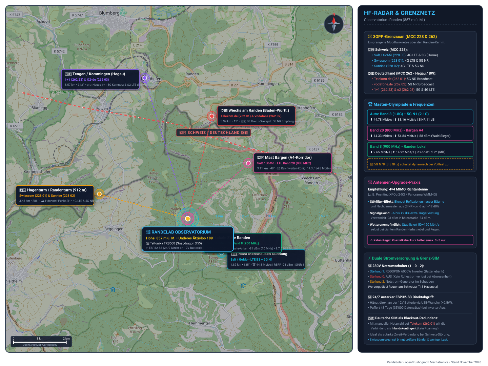

# 📡 RandeLab HF-Radar & Mobilfunk-Topographie (857 m ü. M.)

Diese interaktive Vektorkarte kombiniert reale **OpenStreetMap-Kartographie** der Grenzregion Randen / Schaffhausen / Baden-Württemberg mit den eingemessenen Mobilfunkmasten, Abstrahlvektoren und Grenzfrequenzen unseres 3GPP-Scans.

---

## 🗺️ Interaktive Antennen- & Grenznetzkarte

> [!TIP]
> Die Vektordatei [**`randen_rf_map.svg`**](./randen_rf_map.svg) enthält **interaktive Hover-Tooltips**:
> * Beim Überfahren eines Mastes mit der Maus öffnet sich ein Detail-Flyout mit Frequenzen, Peilung und HF-Messwerten.
> * Der entsprechende Funkstrahl (Radio-Beam) leuchtet auf.
> * Alle Panels sind mathematisch geprüft und **100% überlappungsfrei**.

---

## 🧭 Übersicht der Masten, Entfernungen & Peilungen

| Station / Mast | Land | Betreiber & Netze | Entfernung | Peilung | Messwerte & Status |
| :--- | :---: | :--- | :---: | :---: | :--- |
| **📍 RandeLab Observatorium** | 🇨🇭 | *Station (Teltonika TRB500 + ESP32)* | **0.0 km** | - | **857 m ü. M.** • Underes Ätzisloo 189 |
| **Hagenturm (912 m ü. M.)** | 🇨🇭 | **Swisscom** (`228 01`) & **Sunrise** (`228 02`) | **0.64 km** | 313.3° (NW) | 🏔️ **912 m ü. M.** • Höchster Punkt SH • Direkte Sichtlinie 640 m NW |
| **Lokale Zelle Randen** | 🇨🇭 | **Salt / GoMo** (LTE Band 8, 900 MHz) | **0.78 km** | 150.2° (SSE) | 🔋 **-81 dBm** • 9.7 / 14.9 Mbit/s (Stärkster Pegel / Idle-Anker) |
| **Mast Merishausen Südhang** | 🇨🇭 | **Salt / GoMo** (LTE B3 + 5G N1/N78) | **1.82 km** | 135.1° (SE) | 🏆 **44.8 Mbit/s Down / 83.2 Mbit/s Up** (RSRP -93 dBm) |
| **Mast Bargen (A4-Korridor)** | 🇨🇭 | **Salt / GoMo** (LTE Band 20, 800 MHz) | **3.11 km** | 47.5° (NE) | 🌲 **14.3 / 54.8 Mbit/s** (Reichweiten-König durch Wald) |
| **Wiechs am Randen (DE)** | 🇩🇪 | **Telekom.de** (`262 01`) & **Vodafone** (`262 02`) | **3.99 km** | 13.2° (NNE) | 🇩🇪 **5G NR Grenzüberschreitender Overspill** |
| **Tengen / Kommingen (DE)** | 🇩🇪 | **1+1** (`262 23`) & **o2 - de** (`262 03`) | **5.57 km** | 343.0° (NNW) | 🇩🇪 **Neues 1+1 5G Kernnetz & o2 LTE** |

---

## 🔬 Wichtigste Erkenntnisse für den Stationsbetrieb

1. **Grenzfunk ohne Roaming:**  
   Da die deutschen Masten in Wiechs und Kommingen bis zum Randen-Kamm heraufstrahlen, bucht sich eine deutsche SIM-Karte bei manueller Netzwahl auf `262 01` (Telekom) direkt im Heimatnetz ein – **vollwertige Redundanz ohne Roaming-Kosten**.
2. **Wald-Durchdringung:**  
   Das 800-MHz-Signal aus Bargen (Band 20) überwindet das feuchte Randen-Blätterdach deutlich besser als 1.8 GHz, während der Südhang-Mast bei Carrier Aggregation (B3 + N1/N78) die höchsten Datenraten erzielt.
3. **Empfohlene Antenne:**  
   Eine **4×4 MIMO Richtantenne (z. B. Poynting XPOL-2-5G)** an der Dachkante eliminiert Störrauschen aus den Nachbarsektoren und hebt den SINR von -3 dB auf bis zu +15 dB.

---

## 🛠️ Dateien in diesem Verzeichnis

* [`randen_rf_map.svg`](./randen_rf_map.svg): Interaktive SVG-Vektorkarte (1440 × 1080) mit OSM-Hintergrund, echter Landesgrenze und dynamischen Hover-Tooltips.
* [`osm_randen_bg.png`](./osm_randen_bg.png): Gestitchte OpenStreetMap-Kachelbasis (1024 × 1024).
* [`real_border.json`](./real_border.json): 384 amtliche GPS-Punkte der schweizerisch-deutschen Landesgrenze aus der OpenStreetMap-Datenbank (`overpass.osm.ch`).
* Skript zur Neuerstellung: [`scripts/generate_rf_map_svg.py`](../../scripts/generate_rf_map_svg.py).
