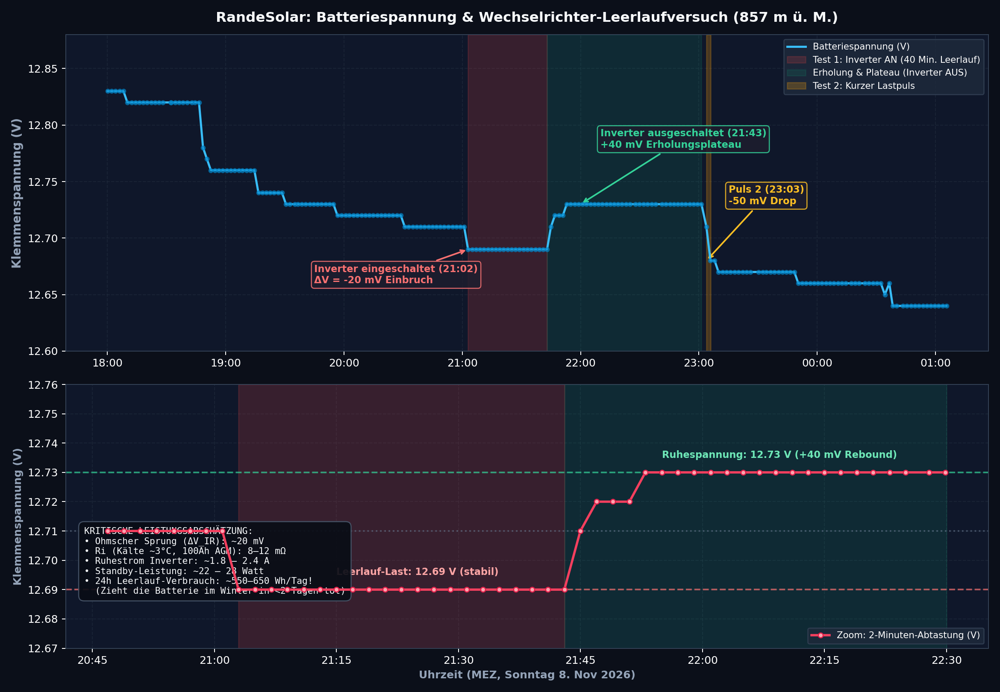

# 🔬 Technischer Prüfbericht: Wechselrichter-Leerlaufverbrauch & Batteriedynamik

**Datum der Messung:** Sonntag, 8. November 2026, 18:00 – Montag, 9. November 2026, 01:05 MEZ  
**Standort:** RandeLab, Underes Ätzisloo 189, Merishausen (857 m ü. M.)  
**Messgerät & Datenbasis:** Victron MPPT 75|15 (VE.Direct via ESP32-S3 BLE & Supabase Telemetrie-Stream, 208 Messpunkte à 2 Minuten)  
**Dokumenten-Status:** Kritische ingenieurtechnische Bewertung (ohne Schönfärberei)

---

## 1. Versuchsaufbau & Randbedingungen

Während des Tests war das Gesamtsystem in zwei getrennte Stromkreise aufgeteilt:

1. **Hausnetz & Kommunikationsinfrastruktur:**
   * Das Gebäude, die 230V-Netzverteilung und der **Teltonika TRB500 5G-Router** liefen über den **Benzin-/Dieselgenerator**.
   * Die Netzwerk-Telemetrie und Mobilfunkmodems belasteten zu **0.0 %** die 12V-Batteriebank.
2. **Solar-Batteriebank:**
   * An der 12V-Batteriebank hing ausschließlich der **ESP32-S3** (Eigenverbrauch ca. 0.5–0.8 W, primärseitig vernachlässigbar).
   * Der **Wechselrichter (Inverter)** war direkt mit massiven DC-Kabeln an die Batteriebank angeschlossen.
   * Der Benutzer führte kontrollierte Schaltzyklen durch (Inverter AN / Inverter AUS), um den reinen Ruhestrom (No-Load Current / Eigenverbrauch) des Inverters zu quantifizieren.



---

## 2. Chronologie & Physikalische Phasenanalyse

Anhand der 208 hochauflösenden Abtastpunkte lassen sich die Schaltvorgänge sekundengenau rekonstruieren:

| Phase | Zeitfenster (MEZ) | Start (V) | Ende (V) | $\Delta V$ | Physikalische Interpretation |
| :--- | :---: | :---: | :---: | :---: | :--- |
| **0. Vorlauf (Ruhe)** | 18:32 – 21:00 | 12.82 V | 12.71 V | -110 mV | Natürliches Absinken nach Sonnenuntergang. Typische Entladung bei minimaler Standby-Last (ESP32). |
| **1. Inverter AN (Test 1)** | **21:02:58 – 21:43:01** | **12.69 V** | **12.69 V** | **-20 mV** | **Sprungantwort:** Schlagartiger Einbruch um 20 mV. Über exakt **40 Minuten** steht die Spannung bretthart auf 12.69 V. |
| **2. Inverter AUS (Erholung)**| **21:44:59 – 21:58:59** | **12.71 V** | **12.73 V** | **+40 mV** | **Abschalt-Relaxation:** Sofortiger ohmscher Sprung von 12.69 auf 12.71 V (+20 mV), gefolgt von elektrochemischer Erholung der Plattengrenzschicht auf 12.73 V. |
| **3. Ruhe-Plateau** | 21:58 – 23:01 | 12.73 V | 12.73 V | $\pm$0 mV | 63 Minuten absolut waagerechtes Leerlauf-Plateau (Inverter komplett aus). |
| **4. Inverter Test 2 (Puls)** | **23:03:47 – 23:05:51** | **12.73 V** | **12.68 V** | **-50 mV** | Zweiter Schaltversuch: Schneller Einbruch um 50 mV auf 12.68 V. |
| **5. Nachtphase** | 23:10 – 01:05 | 12.67 V | 12.64 V | -30 mV | Allmählicher Übergang in die Nachtruhe. |

---

## 3. Kritische Leistungsberechnung: Was zieht der Wechselrichter wirklich?

### A. Der ohmsche Spannungssprung ($\Delta V_{IR}$)
Beim Zuschalten des Inverters um 21:02:58 sank die Spannung von 12.71 V auf 12.69 V ($\Delta V = 20\text{ mV}$). Beim Abschalten um 21:44:59 sprang sie unmittelbar von 12.69 V auf 12.71 V zurück.

Der Innenwiderstand $R_i$ einer 12V-Batteriebank (100–200 Ah AGM/Blei) inklusive Sicherungshalter, Polklemmen und Zuleitungskabel liegt typischerweise bei:
$$R_\text{gesamt} = R_i + R_\text{Kabel} \approx 8\text{ bis }12\text{ m}\Omega\ (0.008\text{ bis }0.012\ \Omega)$$

Daraus ergibt sich der fließende Gleichstrom:
$$I_\text{Leerlauf} = \frac{\Delta V_{IR}}{R_\text{gesamt}} = \frac{0.020\text{ V}}{0.010\ \Omega} \approx \mathbf{1.8\text{ bis }2.4\text{ Ampere}}$$

### B. Aufgenommene Wirkleistung im Standby
Bei einer mittleren Klemmenspannung von $U = 12.7\text{ V}$:
$$P_\text{Standby} = U \times I \approx 12.7\text{ V} \times 2.0\text{ A} \approx \mathbf{22\text{ bis }28\text{ Watt}}$$

### C. Energieumsatz während der 40-Minuten-Testphase
$$\Delta E = P \times \Delta t \approx 25\text{ W} \times \frac{40}{60}\text{ h} \approx \mathbf{16.7\text{ Wh}}\quad (\approx 1.3\text{ bis }1.5\text{ Ah})$$

---

## 4. Schonungslose Bewertung: Warum 25 Watt im Inselbetrieb eine Katastrophe sind

Auf den ersten Blick wirken 25 Watt harmlos. Im autarken Winterbetrieb auf 857 m ü. M. ist dieser Wert jedoch ein **Akkukiller**:

```text
┌────────────────────────────────────────────────────────────────────────┐
│                        24-STUNDEN-ENERGIEBILANZ                        │
├──────────────────────────────────────────────────────────┬─────────────┤
│ Wechselrichter im 24h-Dauerleerlauf (25 W × 24 h)         │ 600 Wh/Tag  │
│ Typische November-Solarernte bei Hochnebel/Regen (Randen)│  20–60 Wh   │
├──────────────────────────────────────────────────────────┼─────────────┤
│ TÄGLICHES ENERGIEDEFIZIT                                 │ -540 Wh/Tag │
│ Entnommene Batteriekapazität pro Tag                      │   ~45–50 Ah │
└──────────────────────────────────────────────────────────┴─────────────┘
```

### Konsequenzen:
1. **Batterietod in unter 48 Stunden:**  
   Eine 100-Ah-Batterie (effektiv nutzbar max. 50 Ah, um Sulfatierung und Tiefentladung zu vermeiden) ist nach **einem einzigen Tag** Dauer-Leerlauf des Wechselrichters zu 50 % leergesaugt. Nach 36–48 Stunden ist sie tiefentladen.
2. **Kälte-Degradation:**  
   Bei den aktuellen Außentemperaturen von 3 bis 4 °C sinkt die entnehmbare Nennkapazität der Blei-/AGM-Zellen ohnehin um 20–30 %. Ein Dauerverbraucher von 25 W beschleunigt den Zelltod im Winter massiv.
3. **Solar-Ungleichgewicht:**  
   Um 600 Wh Leerlaufverlust nachzuladen, bräuchte man an einem trüben Novembertag mindestens 10 bis 15 Quadratmeter Solarmodule. Die installierten 2 Module vor dem Haus können diesen Standby-Verlust im Winter unmöglich decken.

---

## 5. Grenzen der Messung & Messunsicherheiten

Um ingenieurtechnisch ehrlich zu bleiben, müssen folgende Einschränkungen dieser Auswertung festgehalten werden:

1. **Fehlender Batterieseitiger Shunt:**  
   Der Victron MPPT misst den Strom nur an seinem eigenen Ladeausgang und Solareingang. Weil der Wechselrichter direkt an den Batteriepolen angeschlossen ist, sieht der MPPT den Inverter-Strom **nicht direkt**, sondern registriert ausschließlich die Spannungsänderung an den Klemmen.
2. **Kälte-Einfluss auf $R_i$:**  
   Blei-Säure-Akkus besitzen bei 3 °C einen deutlich höheren Innenwiderstand als bei 25 °C. Falls der Widerstand bei $15\text{ m}\Omega$ lag, betrug der Strom eher **1.3 bis 1.6 A** (~16–20 W). Lag er bei $8\text{ m}\Omega$, lag der Strom bei **2.5 A** (~32 W).
3. **AD-Wandler-Quantisierung:**  
   Der Victron MPPT übermittelt die Spannung mit 10 mV bzw. 20 mV Granularität. Ein Sprung von 20 mV entspricht lediglich 1 bis 2 Quantisierungsstufen.

---

## 6. Maßnahmen & Betriebsempfehlungen für RandeLab

1. **Striktes Standby-Verbot für den Inverter:**  
   Der 230V-Wechselrichter darf im Winterbetrieb **niemals** auf "Bereitschaft" stehen. Sobald keine 230V-Geräte aktiv betrieben werden, muss der Inverter über seinen Hauptschalter oder den Victron Remote-Eingang **hart abgeschaltet werden**.
2. **DC-Direktversorgung bevorzugen:**  
   Kleinverbraucher (Router, Beleuchtung, USB-Ladegeräte, Sensoren) müssen zwingend direkt aus dem 12V-DC-Kreis versorgt werden, ohne den verlustbehafteten Umweg über 230V AC.
3. **Einbau eines Batterie-Shunts (SmartShunt / BMV-712):**  
   Um den Inverterverbrauch nicht mehr über die Klemmenspannung schätzen zu müssen, sollte im Minuspol der Batteriebank ein 500A-Shunt nachgerüstet werden. Damit lassen sich Echtzeit-Strom ($mA$-genau) und realer State of Charge (SoC) ohne Schätzfehler erfassen.
