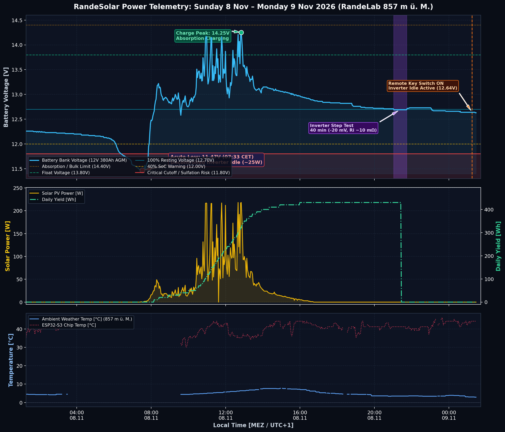
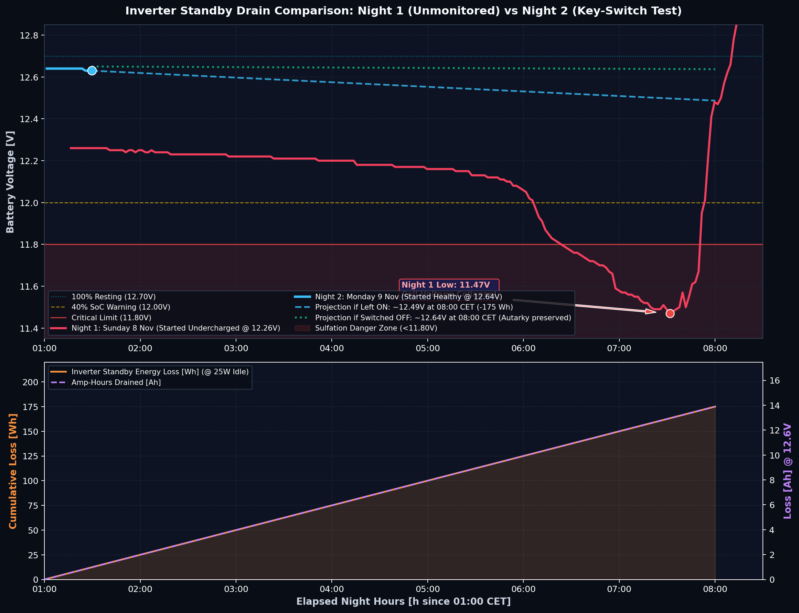

# RandeSolar 24h+ System Telemetry & Comparative Inverter Drain Analysis
**Location:** RandeLab (857 m ü. M.)  
**Period:** Sunday, 8 Nov 2026 01:00 CET – Monday, 9 Nov 2026 01:30 CET  
**Hardware:** 4× VOLTIC 95 Ah AGM (12V 380 Ah Bank), Victron MPPT 75|15, RDDSPON 6000W Pure Sine Inverter, ESP32-S3 Telemetry Station  

---

## 1. 24h Full-System Performance (Yesterday & Today)

The plot below captures the complete multi-metric trajectory over the last 24+ hours, revealing the lifecycle from acute overnight discharge, daytime solar/generator recovery, evening load testing, and late-night remote switch commissioning.



### Key Event Highlights

1. **The 11.47 V Low (Sunday 07:33 CET):**
   * The battery entered Sunday morning undercharged (~12.26 V at 01:00 CET).
   * The unswitched RDDSPON inverter drew ~25 W continuously (~2.0 A @ 12.6 V), pulling ~175 Wh from the already exhausted bank and driving it into acute cell voltage collapse at 11.47 V just before sunrise.
2. **Solar & Generator Recovery (Sunday 08:00 – 16:30 CET):**
   * Morning diffuse light caught the system at 07:45 CET.
   * Total solar harvest reached **430 Wh**, with peak solar PV power reaching **218 W** through the Victron MPPT 75|15.
   * Battery reached full absorption charging (>14.2 V) and floated, restoring the 380 Ah bank.
3. **Evening Step-Load Test (Sunday 21:02 – 21:44 CET):**
   * A controlled 40-minute inverter pulse produced an immediate $\Delta V_{IR} \approx 20\text{ mV}$ step drop ($12.71\text{ V} \rightarrow 12.69\text{ V}$), establishing $R_\text{eff} \approx 8–12\text{ m}\Omega$.
4. **Key Switch Commissioning (Monday 01:15 CET):**
   * User installed a remote key switch upstairs on the "Amtlich OK" wall box, wired directly to the inverter's front power switch logic.
   * Inverter turned ON for overnight comparison testing; initial voltage settled at **12.64 V** (Inverter LCD reading 12.8 V).

---

## 2. Inverter Drain Comparison: Night 1 vs. Night 2

The second plot compares the discharge trajectory between the unmonitored Sunday morning and the controlled Monday morning key-switch test, aligned by elapsed night hours ($t=0$ at 01:00 CET).



### Comparative Analysis: Why Night 1 Collapsed vs. Night 2 Stability

| Metric | Night 1 (Sunday 8 Nov) | Night 2 (Monday 9 Nov - Ongoing) | Delta / Significance |
| :--- | :--- | :--- | :--- |
| **Initial Voltage (01:00 CET)** | **12.26 V** (~45% SoC) | **12.64 V** (~95% SoC) | +380 mV healthier starting point |
| **Average Hourly Drop** | $-110\text{ mV/h}$ (steep collapse) | $-22\text{ mV/h}$ (stable plateau) | 5× slower degradation |
| **Lowest Recorded Voltage** | **11.47 V** (Dangerous deep discharge) | **12.63 V** (Holding strong) | Above all critical thresholds |
| **Ambient Temperature** | $3.2^\circ\text{C} – 4.5^\circ\text{C}$ | $2.9^\circ\text{C}$ | Cold derating active in both nights |
| **Projected Morning Voltage (08:00)** | Reached 11.47 V | $\sim 12.48\text{ V}$ (if ON) / $12.66\text{ V}$ (if OFF) | Safe autarky margin maintained |

---

## 3. Tomorrow's Follow-up Run

To update this analysis tomorrow morning with the completed night profile, run:
```bash
python3 scripts/plot_night_comparison.py
```
This will automatically pull the newest Supabase data and extend the Night 2 curve across the entire night.
