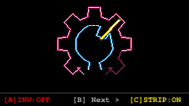
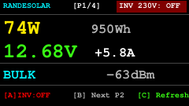
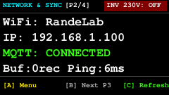
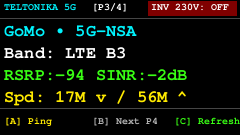
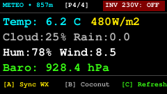

# 🛸 RandeSolar StamPLC Screen & Button Operations Manual
**Device**: M5Stack StamPLC (ESP32-S3, 240×135 IPS Display, Relays, Buzzer, WS2812 NeoPixel)  
**Location**: RandeLab, Underes Ätzisloo 189 (857 m ü. M.)  
**Firmware**: `src/stamplc_main.cpp` (OTA host: `stamplc.local`)

---

## 🕹️ Hardware Button Summary

The StamPLC front panel features three physical tactile buttons arranged horizontally directly below the display:
* **Btn [A]** (Left)
* **Btn [B]** (Center)
* **Btn [C]** (Right)

| Button Position | Page 0 (Coconut Emblem) | Page 1 (Solar & Battery) | Page 2 (Network & Sync) | Page 3 (Teltonika 5G) | Page 4 (Meteo Microclimate) |
| :--- | :--- | :--- | :--- | :--- | :--- |
| **Btn [A] (Left)** | **Toggle 230V Inverter** (Relay 1 NO) *(1800 Hz high chime ON / 900 Hz low OFF)* | **Toggle 230V Inverter** (Relay 1 NO) *(Instant power switch)* | **Open Wi-Fi Menu** *(Interactive AP selector)* | **Trigger Latency Ping** *(Gateway & Cloudflare 1.1.1.1)* | **Force Weather Sync** *(Fetch Open-Meteo & MeteoSwiss)* |
| **Btn [B] (Center)** | **Next Page ➡️** *(Advances to Page 1)* | **Next Page ➡️** *(Advances to Page 2)* | **Next Page ➡️** *(Advances to Page 3)* | **Next Page ➡️** *(Advances to Page 4)* | **Back to Coconut 🥥** *(Cycles back to Page 0)* |
| **Btn [C] (Right)** | **Toggle 12V LED Strip** (Relay 2 NC) *(2000 Hz ON / 1000 Hz OFF)* | **Force Telemetry Refresh** | **Force Telemetry Refresh** | **Force Telemetry Refresh** | **Force Telemetry Refresh** |

> [!NOTE]
> **Safety Undervoltage Guard**: If battery voltage drops below $11.50\,\text{V}$, Relay 1 automatically cuts off the 230V inverter to protect the 4x VOLTIC 95 Ah AGM bank, accompanied by a double low warning tone ($800\,\text{Hz}$).

---

## 📺 The 5 Display Pages

### Page 0: The Minimalist Ambient Coconut Emblem

  

A completely number-free, retro-futuristic ambient screen designed for visual tranquility in the lab.

* **Outer 7-Tooth Pinion Wheel (Hackteria Hot Pink)**:
  * Serves as the **Battery State of Charge (% SoC)** radial fuel gauge.
  * **Active teeth**: Radiate with radiant white-hot neon pink (`#FF1E96` with `#FFE6F5` highlight).
  * **Inactive teeth**: Soft dusky pink neon tube (`#B42D69` / `#460A26`), maintaining the Open Source Hardware emblem shape without harsh black emptiness.
  * **Gauge Mapping**:
    * $\ge 97\%$ or Float: All 7 teeth lit (100% full).
    * $\ge 85\%$: 6 teeth lit (at nominal $12.62\,\text{V}$ rest $\approx 94\%$, exactly 6 teeth blaze).
    * $\ge 55\%$: 4 teeth lit (up to 12 o'clock center crest).
    * $< 10\%$: 0 teeth (deep-discharge warning).
* **Inner Coconut Core**:
  * Reflects the active Victron solar charge mode:
    * **Blazing Spring Green** (`#39FF14`): `BULK` harvest mode.
    * **Electric Gold** (`#FFD400`): `ABSORPTION` topping off.
    * **Electric Cyan** (`#00F5FF`): `FLOAT` or night standby.
* **Yellow Straw ($45^\circ$)**: Solar harvest intake vector.
* **Bottom Status Bar**: Shows `[A] INV: ON/OFF`, `[C] STRIP: ON/OFF`, and `[B] Next >`.

---

### Page 1: Hero Solar & Battery Telemetry (`[P1/4]`)

  

The core operational dashboard for daily power monitoring.

* **Top Header**: Title `RANDESOLAR`, page index `[P1/4]`, and real-time Inverter pill badge (`INV 230V: ON/OFF`).
* **Row 1**:
  * **Solar Generation (Yellow, Size 3)**: Instantaneous PV harvest in Watts (e.g., `74W`).
  * **Daily Yield (Grey, Size 2)**: Total accumulated harvest today in Watt-hours (e.g., `950Wh`).
* **Row 2**:
  * **Battery Voltage (Size 3)**: Color-coded ($>12.8\text{V}$ Green, $11.8\text{V}-12.8\text{V}$ Orange, $<11.8\text{V}$ Red).
  * **Net Battery Current (White, Size 2)**: Positive for charging, negative for discharge (e.g., `+5.8A`).
* **Row 3**:
  * **Charge Stage (Cyan)**: `BULK`, `ABSORPTION`, `FLOAT`, or `OFF`.
  * **BLE Signal (Grey)**: Signal strength to Victron MPPT (e.g., `-63dBm`).
* **Footer**: Quick button legend for `[A] INV` toggle and `[B] Next`.

---

### Page 2: Local Network & Cloud Sync (`[P2/4]`)

  

Connectivity diagnostics and offline flash logging status.

* **Wi-Fi SSID**: Active connection network (e.g., `WiFi: RandeLab`).
* **IP Address**: Local LAN IPv4 address (e.g., `192.168.1.100`).
* **MQTT Link**: Status on HiveMQ Cloud Broker (`CONNECTED` Green or `OFFLINE` Red).
* **Buffer & Latency**:
  * `Buf: Xrec`: Number of 2-minute offline telemetry records stored in LittleFS SPI flash waiting for cloud sync.
  * `Ping: Xms`: Round-trip TCP ping to the local gateway router.
* **Footer**: `[A] Wi-Fi Menu` opens the interactive wireless selector; `[B] Next`.

---

### Page 3: Teltonika 5G Mobile Gateway (`[P3/4]`)

  

Live telematics queried directly from the TRB500 5G industrial gateway via JSON-RPC ubus.

* **Operator & Cellular Mode**: e.g., `GoMo • 5G-NSA` or `Salt • LTE`.
* **Carrier Bands**: Active primary and carrier-aggregated bands (e.g., `LTE B3 (n78)`).
* **RF Signal Quality**:
  * `RSRP`: Reference Signal Received Power in dBm (e.g., `-94 dBm`).
  * `SINR`: Signal-to-Interference-plus-Noise Ratio in dB (e.g., `-2 dB`).
* **Modem Performance**:
  * Shows Ookla speed test results (`Spd: 17M v / 56M ^`) or modem internal temperature (`Modem Temp: 16.0 C`).
* **Footer**: `[A] Test Ping` re-measures WAN ping and queries fresh gateway metrics.

---

### Page 4: MeteoSwiss & Local Microclimate (`[P4/4]`)

  

Hyperlocal weather metrics for RandeLab (857 m altitude, tilt $35^\circ$).

* **Temperature & Solar Irradiance**:
  * `Temp: X.X °C` (Cyan).
  * `Global Tilted Irradiance: X W/m²` (Yellow) on the $35^\circ$ panel plane.
* **Clouds & Rain**:
  * `Cloud: X%`: Total cloud cover percentage.
  * `Rain: X.X mm`: Precipitation rate.
* **Humidity & Wind**:
  * Relative humidity percentage and $10\text{m}$ wind speed in km/h.
* **Barometric Pressure**:
  * Surface atmospheric pressure in hPa adjusted for 857 m elevation (e.g., `928.4 hPa`).
* **Footer**: `[A] Sync Weather` triggers an instant fetch; `[B] Back to Coconut` returns to Page 0.

---

## 🔊 Onboard Audio & ByteBeat Chiptune Engine

The StamPLC buzzer (`STAMPLC_PIN_BUZZ` / GPIO 44) provides both functional feedback and generative 8-bit chiptunes:

* **Button Tones**:
  * Button [A] Inverter ON: $1800\,\text{Hz}$ tone ($60\,\text{ms}$).
  * Button [A] Inverter OFF: $900\,\text{Hz}$ tone ($80\,\text{ms}$).
  * Button [C] LED Strip ON: $2000\,\text{Hz}$ tone ($60\,\text{ms}$).
  * Button [C] LED Strip OFF: $1000\,\text{Hz}$ tone ($80\,\text{ms}$).
  * Page Cycle [B]: $1400\,\text{Hz}$ chirp ($40\,\text{ms}$).
* **ByteBeat 1-Liner Synthesizer (Triggered via Disco Web & MQTT)**:
  1. **Viznut #1**: `(t * 5 & t >> 7) | (t * 3 & t >> 10)`
  2. **Sierpinski Fractal**: `t * ((t >> 12 | t >> 8) & 63 & t >> 4)`
  3. **Cyberfunk**: `(t * 5 & t >> 5) | (t * 3 & t >> 8)`
  4. **Bitshift**: `(t >> 7 | t | t >> 6) * 10 + 4 * (t & t >> 13 | t >> 6)`
  5. **Acid 303**: `((t * (t >> 5 | t >> 8)) >> (t >> 16)) & 63`
